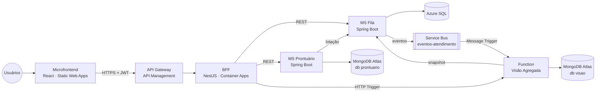

# Open Prontuário — Plataforma

Repositório "guarda-chuva" do projeto **Open Prontuário** (PJBL — Cloud): documentação de arquitetura (arc42, C4, Canvas), contratos entre serviços (OpenAPI e AsyncAPI), **docker compose** que sobe a solução inteira localmente, infraestrutura Azure em **Bicep**, script de publicação no Docker Hub e o **smoke test E2E**.

## Arquitetura



| Repositório | Papel |
|---|---|
| [`open-prontuario-frontend`](../open-prontuario-frontend) | Microfrontend React (áreas Paciente, Atendente e Gestor) |
| [`open-prontuario-bff`](../open-prontuario-bff) | BFF Node.js/NestJS: auth, perfis, proxy, `GET /aggregated-data` |
| [`open-prontuario-ms-fila-sql`](../open-prontuario-ms-fila-sql) | Microserviço Azure SQL: unidades, lotações e fila; publica eventos |
| [`open-prontuario-ms-prontuario-mongo`](../open-prontuario-ms-prontuario-mongo) | Microserviço MongoDB: prontuário, consentimento e auditoria |
| [`open-prontuario-fn-visao-agregada`](../open-prontuario-fn-visao-agregada) | Azure Function: Message Trigger, DLQ Trigger e HTTP Trigger |
| `open-prontuario-platform` (este) | Docs, contratos, compose, Bicep, scripts |

## Conteúdo

```
docs/
  arc42_open_prontuario_pjbl.md   arc42 desta entrega (Canvas, C4, ADRs, links da entrega)
  contracts/                      CONVENCOES.md + OpenAPI de cada serviço + asyncapi.yaml
  diagramas/                      fontes PlantUML e PNGs (C4 1–3, sequência, estados, DER, implantação)
  origem/                         arc42 e OpenAPI da entrega anterior (monólito)
  video/ROTEIRO.md                roteiro do vídeo com falas dos 4 integrantes
  prints/CHECKLIST.md             prints obrigatórios
  DEPLOY.md                       passo a passo do deploy em nuvem
  VERIFICACAO.md                  o que foi verificado e como
infra/bicep/                      main.bicep + módulos (APIM, Container Apps, Functions, Service Bus, SQL, SWA, App Insights)
servicebus/Config.json            tópico/subscription do Service Bus Emulator
scripts/e2e-smoke.mjs             smoke test ponta a ponta contra o BFF
scripts/docker-publish.sh         build + push das imagens no Docker Hub
compose.yml · Makefile · .env.example
```

## Tecnologias

Docker Compose · SQL Server 2022 · Azure Service Bus Emulator · MongoDB 7 · Azurite · Bicep · Azure API Management · Azure Container Apps · Azure Functions · Azure Static Web Apps · Azure SQL · MongoDB Atlas · PlantUML · Redocly · AsyncAPI CLI.

## Como rodar tudo localmente

Pré-requisitos: Docker Desktop com ~4 GB de memória e Node 20+. Clone os 6 repositórios **lado a lado** na mesma pasta.

```bash
make up
```

Isso cria o `.env` com valores locais, constrói as 5 imagens e sobe tudo (bancos, Service Bus Emulator, serviços, BFF e frontend). Aguarde ~3 minutos e abra http://localhost:8080. Para conferir de ponta a ponta:

```bash
make e2e
```

Para derrubar tudo e apagar os dados locais:

```bash
make down
```

| Serviço | URL local |
|---|---|
| Frontend | http://localhost:8080 |
| BFF + Swagger | http://localhost:3000/api/docs |
| MS Fila Swagger | http://localhost:8081/swagger-ui.html |
| MS Prontuário Swagger | http://localhost:8082/swagger-ui.html |
| Function (HTTP) | http://localhost:7071/api/health |

Em Macs Apple Silicon, SQL Server e o runtime Java do Functions rodam emulados (amd64): a primeira subida leva alguns minutos.

## Como rodar em nuvem

```bash
./scripts/azure.sh subir      # liga tudo
./scripts/azure.sh desligar   # apaga tudo (custo zero)
```

Configuração inicial (Atlas, Docker Hub e `.env.azure`) e custos em [`docs/DEPLOY.md`](docs/DEPLOY.md). A apresentação usa somente as URLs de nuvem (`./scripts/azure.sh status`).

## Validações deste repositório

```bash
make lint-contratos
```

```bash
az bicep build --file infra/bicep/main.bicep
```

## Alunos

- Ana Paula Alves
- Artur Bertoni
- Bernardo Plottegher
- Luiz Fernando Grenteski
