# Alunos {.unnumbered}

| Integrante | Papel principal no projeto |
|---|---|
| Ana Paula Alves | MS Fila (Azure SQL): domínio da fila, máquina de estados e eventos |
| Artur Bertoni | MS Prontuário (MongoDB): consentimento, prontuário e auditoria |
| Bernardo Plottegher | Function Visão Agregada, Service Bus e infraestrutura Azure (Bicep, API Management) |
| Luiz Fernando Grenteski | BFF, Microfrontend e testes de arquitetura |

Todos os integrantes participam da documentação, da revisão de código e do vídeo.

# Links da entrega {.unnumbered}

> Links de nuvem gerados por `./scripts/azure.sh subir` (consulte com `./scripts/azure.sh status`). Tudo escala a zero: o primeiro acesso depois de um tempo parado leva até ~1 min.

| Artefato | Link |
|---|---|
| GitHub — Microfrontend | https://github.com/fergrenteski/open-prontuario-frontend |
| GitHub — BFF | https://github.com/fergrenteski/open-prontuario-bff |
| GitHub — Microserviço MongoDB | https://github.com/fergrenteski/open-prontuario-ms-prontuario-mongo |
| GitHub — Microserviço Azure SQL | https://github.com/fergrenteski/open-prontuario-ms-fila-sql |
| GitHub — Azure Function | https://github.com/fergrenteski/open-prontuario-fn-visao-agregada |
| GitHub — Plataforma (docs, compose, Bicep) | https://github.com/fergrenteski/open-prontuario-platform |
| Docker Hub — BFF | https://hub.docker.com/r/fergrenteski/pjbl-bff |
| Docker Hub — MS Fila | https://hub.docker.com/r/fergrenteski/pjbl-ms-fila-sql |
| Docker Hub — MS Prontuário | https://hub.docker.com/r/fergrenteski/pjbl-ms-prontuario-mongo |
| Docker Hub — Function | https://hub.docker.com/r/fergrenteski/pjbl-fn-visao-agregada |
| Docker Hub — Frontend | https://hub.docker.com/r/fergrenteski/pjbl-frontend |
| Swagger — BFF | https://ca-bff.gentletree-a28fd1cb.brazilsouth.azurecontainerapps.io/api/docs |
| Swagger — MS Fila | https://ca-ms-fila-sql.gentletree-a28fd1cb.brazilsouth.azurecontainerapps.io/swagger-ui.html |
| Swagger — MS Prontuário | https://ca-ms-prontuario-mongo.gentletree-a28fd1cb.brazilsouth.azurecontainerapps.io/swagger-ui.html |
| OpenAPI — Function (HTTP Trigger) | https://github.com/fergrenteski/open-prontuario-platform/blob/main/docs/contracts/fn-visao-agregada.openapi.yaml |
| Eventos (AsyncAPI) | https://github.com/fergrenteski/open-prontuario-platform/blob/main/docs/contracts/asyncapi.yaml |
| Frontend | https://lemon-meadow-08591770f.1.azurestaticapps.net |
| API Gateway | https://apim-openpront-kuuqj6ka4e67k.azure-api.net/api (exige o header `Ocp-Apim-Subscription-Key`; sem ele, 401) |
| Azure Function (HTTP Trigger) | https://func-openpront-kuuqj6ka4e67k.azurewebsites.net/api/health |
| Vídeo no YouTube (não listado) | `<PREENCHER>` |

\newpage

# Software Architecture Canvas {.unnumbered}

| Bloco | Conteúdo |
|---|---|
| **Business Case** | Reduzir o tempo até o atendimento dos casos mais graves nas UPAs: o atendente vê uma fila ordenada por risco clínico e, com consentimento explícito do paciente (modelo Open Finance), acessa o prontuário antes da chegada física. |
| **Business Context** | Rede de UPAs e UBSs de um município (SUS), com pacientes que se deslocam por conta própria até a unidade. |
| **Functional Overview** | Área do paciente (UPAs próximas com indicadores, aviso de chegada com sintomas, consentimento, meu prontuário e quem o acessou), área do atendente/profissional (fila priorizada, confirmação de chegada, repriorização, prontuário autorizado, início e encerramento) e área do gestor (indicadores agregados, auditoria, cadastro de unidades e lotações). |
| **Quality Goals** | 1. Privacidade e sigilo · 2. Desempenho em picos · 3. Disponibilidade com degradação graciosa · 4. Usabilidade do atendente · 5. Economicidade · 6. Manutenibilidade |
| **Organisational Constraints** | Equipe de 4 alunos · prazo do semestre · Azure for Students (crédito limitado) · LGPD · requisitos do PJBL (microserviços, BFF, microfrontend, Function, gateway, Docker Hub, repositórios públicos) |
| **Technical Constraints** | Microfrontend React · BFF Node.js (NestJS) · microserviços Java 17/Spring Boot 3 · MongoDB Atlas (free) · Azure SQL (free) · Azure Functions · Azure Service Bus · API Management · Clean Architecture + Vertical Slice com testes de arquitetura |
| **Architecture Overview** | Microfrontend → API Gateway → BFF → { MS Fila (Azure SQL), MS Prontuário (MongoDB), Function Visão Agregada }. Mudanças da fila viram eventos no Service Bus, consumidos pela Function, que mantém a visão agregada. Cada componente é organizado em `domain / application (slices por feature) / infrastructure / api / bootstrap`. |
| **Architecture Hypotheses** | Persistência poliglota: documentos heterogêneos (prontuário) no MongoDB, fila relacional e transacional no SQL · Mensageria absorve picos e desacopla indicadores da operação · O BFF consegue entregar a tela do atendente em uma única chamada mesmo com uma fonte fora (degradação graciosa) |
| **Technical Challenges & Risks** | Consistência eventual da visão agregada · Autorização distribuída (lotação no SQL, consentimento no Mongo) · Cold start (escala a zero) · Custo do Service Bus Standard · Curva de aprendizado de 3 stacks |

\newpage

# 1. Introdução e Objetivos

## 1.1 Visão Geral dos Requisitos

O Open Prontuário resolve dois problemas da rede de urgência: a unidade só conhece o paciente quando ele chega ao balcão, e o paciente não sabe qual unidade está menos congestionada. No **app web do paciente** ele vê as UPAs próximas com a situação da fila, avisa que está a caminho informando os sintomas e decide se compartilha o prontuário com aquela unidade (consentimento por unidade, com prazo e revogável). No **painel do atendente** a fila aparece ordenada por prioridade clínica, distinguindo quem já chegou de quem está a caminho, e o profissional consulta o prontuário dos pacientes que autorizaram.

Esta entrega reorganiza a solução da entrega anterior (monólito Spring Boot com Cosmos DB, preservado em `docs/origem/`) na arquitetura distribuída exigida pelo PJBL.

### Requisitos Funcionais

| Código | Requisito Funcional |
|---|---|
| RF01 | Autenticação do paciente |
| RF02 | Localização atual e UPAs próximas com status de fila |
| RF03 | Aviso de chegada (paciente a caminho) |
| RF04 | Sintomas informados no aviso de chegada |
| RF05 | Concessão e revogação do consentimento de compartilhamento do prontuário por unidade |
| RF06 | Paciente visualiza o próprio prontuário e o histórico de compartilhamentos |
| RF07 | Autenticação do atendente e seleção da UPA em que está lotado |
| RF08 | Fila da unidade ordenada por prioridade clínica |
| RF09 | Distinção entre pacientes presentes e a caminho |
| RF10 | Confirmação da chegada física |
| RF11 | Alteração da prioridade |
| RF12 | Consulta ao prontuário mediante consentimento válido |
| RF13 | Início do atendimento |
| RF14 | Remoção da fila (atendido, desistência, encaminhado) |
| RF15 | Auditoria de todo acesso a prontuário compartilhado |
| RF16 | Consulta à auditoria de acessos |
| RF17 | Processamento assíncrono dos eventos de mudança de estado da fila |
| RF18 | Visão agregada por unidade (presentes, a caminho, tempo médio de espera) |

### Requisitos do PJBL

| Requisito PJBL | Onde é atendido |
|---|---|
| Microfrontend que consome somente o BFF | `open-prontuario-frontend` (React) → API Gateway → BFF |
| BFF Node.js com agregação e proxy CRUD | `open-prontuario-bff` (NestJS) |
| `GET /aggregated-data` consumindo MS1 + MS2 + Function | `ObterDadosAgregadosUseCase` do BFF (seção 6.1) |
| Microserviço MongoDB com CRUD e Swagger | `open-prontuario-ms-prontuario-mongo` |
| Microserviço Azure SQL com CRUD e Swagger | `open-prontuario-ms-fila-sql` |
| Azure Function HTTP Trigger + Message Trigger | `open-prontuario-fn-visao-agregada` |
| API Gateway | Azure API Management (Consumption) |
| Clean Architecture (Domain, Application, Infrastructure, API) | todos os repositórios (seção 4.1) |
| Vertical Slice | `application/<feature>/<caso-de-uso>` em todos os backends; `features/<area>/<feature>` no front |
| Event-Driven | tópico `eventos-atendimento` + AsyncAPI |
| Testes unitários e de arquitetura | ArchUnit (Java), dependency-cruiser (TypeScript), seção 8.8 |
| Docker Hub | imagens `<usuario>/pjbl-<serviço>:<tag>` |

### Matriz de Rastreabilidade — RF × rota × serviço × caso de uso

Rotas públicas são as do BFF (prefixo `/api`, atrás do gateway). A coluna "Serviço" indica quem implementa a regra.

| RF | Rota no BFF | Serviço | Caso de uso |
|---|---|---|---|
| RF01, RF07 | `POST /auth/dev-token` (dev) ou token do Entra ID; `GET /auth/me` | BFF | `EmitirDevTokenUseCase` / verificação JWT |
| RF02 | `GET /unidades/proximas` | BFF + MS Fila + Function | BFF `ListarUnidadesProximasUseCase` → MS Fila `ListarUnidadesProximasUseCase` + Function `ConsultarVisaoAgregadaUseCase` |
| RF03, RF04 | `POST /fila/{unidadeId}/aviso-chegada` | BFF + MS Fila | BFF `AvisarChegadaUseCase` → MS Fila `AvisarChegadaUseCase` |
| RF05 | `POST /consentimentos`, `PUT/DELETE /consentimentos/{id}` (e `autorizarProntuario` no aviso) | MS Prontuário | `ConcederConsentimentoUseCase`, `RenovarConsentimentoUseCase`, `RevogarConsentimentoUseCase` |
| RF06 | `GET /prontuarios/me`, `GET /consentimentos` | MS Prontuário | `ConsultarProprioProntuarioUseCase`, `ListarConsentimentosUseCase` |
| RF07 | `GET /unidades/minhas` | MS Fila | `ListarMinhasUnidadesUseCase` |
| RF08, RF09 | `GET /fila/{unidadeId}`, `GET /aggregated-data` | BFF + MS Fila + MS Prontuário | MS Fila `ListarFilaPorPrioridadeUseCase`; BFF marca `prontuarioAutorizado` |
| RF10 | `POST /fila/{registroId}/confirmar-chegada` | MS Fila | `ConfirmarChegadaUseCase` |
| RF11 | `PATCH /fila/{registroId}/prioridade` | MS Fila | `AlterarPrioridadeUseCase` |
| RF12, RF15 | `GET /prontuarios/{pacienteId}?unidadeId=` | MS Prontuário (+ MS Fila p/ lotação) | `ConsultarProntuarioUseCase` |
| RF13 | `POST /fila/{registroId}/iniciar-atendimento` | MS Fila | `IniciarAtendimentoUseCase` |
| RF14 | `DELETE /fila/{registroId}?motivo=` | MS Fila | `RemoverDaFilaUseCase` |
| RF16 | `GET /auditoria/prontuarios/{prontuarioId}` | MS Prontuário | `ListarAuditoriaUseCase` |
| RF17 | tópico `eventos-atendimento` (AMQP) | MS Fila → Function | `EventPublisherPort` → `RecalcularVisaoAgregadaUseCase`; DLQ → `RegistrarEventoRejeitadoUseCase` |
| RF18 | `GET /unidades/{id}/visao-agregada`, `GET /aggregated-data` | Function | `ConsultarVisaoAgregadaUseCase` (leitura) e `RecalcularVisaoAgregadaUseCase` (manutenção) |
| CRUD (PJBL) | `/unidades`, `/lotacoes` | MS Fila | casos de uso de `unidade` e `lotacao` |
| CRUD (PJBL) | `/prontuarios`, `/prontuarios/{id}/atendimentos` | MS Prontuário | `CriarProntuarioUseCase`, `AtualizarProntuarioUseCase`, `RemoverProntuarioUseCase`, `RegistrarAtendimentoUseCase` |

## 1.2 Objetivos de Qualidade

| Prioridade | Objetivo | Cenário |
|---|---|---|
| 1 | Privacidade e sigilo | O prontuário só é exibido a profissional lotado na unidade e com consentimento válido do paciente para ela; todo acesso é auditado e, se a auditoria não puder ser gravada, nada é devolvido. |
| 2 | Desempenho | O registro do atendente responde sem esperar o recálculo de indicadores (feito de forma assíncrona). |
| 3 | Disponibilidade | Se a Function ou o MS Prontuário estiverem fora, a fila continua sendo exibida (`/aggregated-data` com `degraded = true`). |
| 4 | Usabilidade | Ações de um clique na fila, atualização automática a cada 5 s, prioridade com cor + ícone + rótulo. |
| 5 | Economicidade | Tiers gratuitos (Atlas M0, Azure SQL free, Static Web Apps Free, Functions e APIM Consumption) e escala a zero dos Container Apps. |
| 6 | Manutenibilidade | Clean Architecture + Vertical Slice verificadas automaticamente em todo build. |

## 1.3 Partes Interessadas

| Função | Expectativa |
|---|---|
| Paciente | Saber para qual UPA ir, avisar que está a caminho e controlar quem vê seu prontuário |
| Atendente / Recepção | Fila priorizada por risco, poucos cliques |
| Profissional de saúde | Prontuário autorizado antes ou durante o atendimento |
| Gestor da unidade | Indicadores, auditoria e cadastros |
| Secretaria municipal de saúde | Conformidade com a LGPD e redução do tempo de espera dos casos graves |
| Professor / avaliador | Requisitos do PJBL demonstrados em nuvem, documentação arc42 e C4 coerentes |
| Equipe (4 integrantes) | Divisão por repositório, revisão cruzada |

\newpage

# 2. Restrições Arquiteturais

| Tipo | Restrição | Explicação |
|---|---|---|
| Técnica (PJBL) | Microfrontend React consumindo só o BFF | O front não conhece os microserviços. |
| Técnica (PJBL) | BFF em Node.js | NestJS + TypeScript. |
| Técnica (PJBL) | MS1 em MongoDB Atlas, MS2 em Azure SQL | Persistência poliglota, cada serviço dono do seu banco. |
| Técnica (PJBL) | Azure Function com HTTP e Message Trigger | Visão agregada. |
| Técnica (PJBL) | API Gateway | Azure API Management (o enunciado permite AWS; a solução é 100% Azure). |
| Técnica (PJBL) | Imagens no Docker Hub, repositórios públicos no GitHub | Um repositório por componente. |
| Técnica | Java 17 + Spring Boot 3 nos microserviços; Java 17 na Function | JDK disponível na equipe; Java 21 não é necessário. |
| Técnica | Clean Architecture + Vertical Slice com testes de arquitetura | ArchUnit e dependency-cruiser no CI. |
| Organizacional | Azure for Students | Crédito limitado; tiers gratuitos e de consumo. |
| Organizacional | LGPD (dados de saúde) | Consentimento explícito, minimização, auditoria. |

\newpage

# 3. Contexto e Escopo

## 3.1 Contexto Negocial — C4 Nível 1

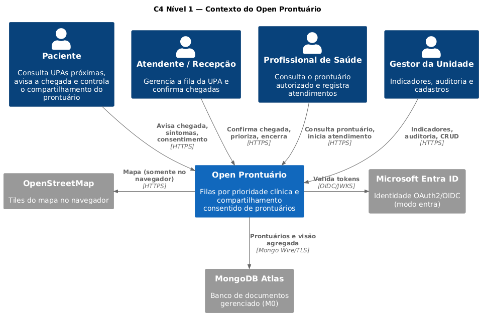

| Elemento externo | Entradas | Saídas |
|---|---|---|
| Paciente | localização, sintomas, aviso, consentimento | UPAs próximas com indicadores, próprio prontuário, consentimentos e acessos |
| Atendente / Profissional | confirmação, prioridade, início, encerramento, consulta ao prontuário | fila priorizada, prontuário autorizado |
| Gestor | cadastros, consultas | indicadores, auditoria |
| Microsoft Entra ID | — | identidade (`oid`, `name`, `roles`) no modo `entra` |
| MongoDB Atlas | — | persistência gerenciada dos documentos |

## 3.2 Contexto Técnico — C4 Nível 2

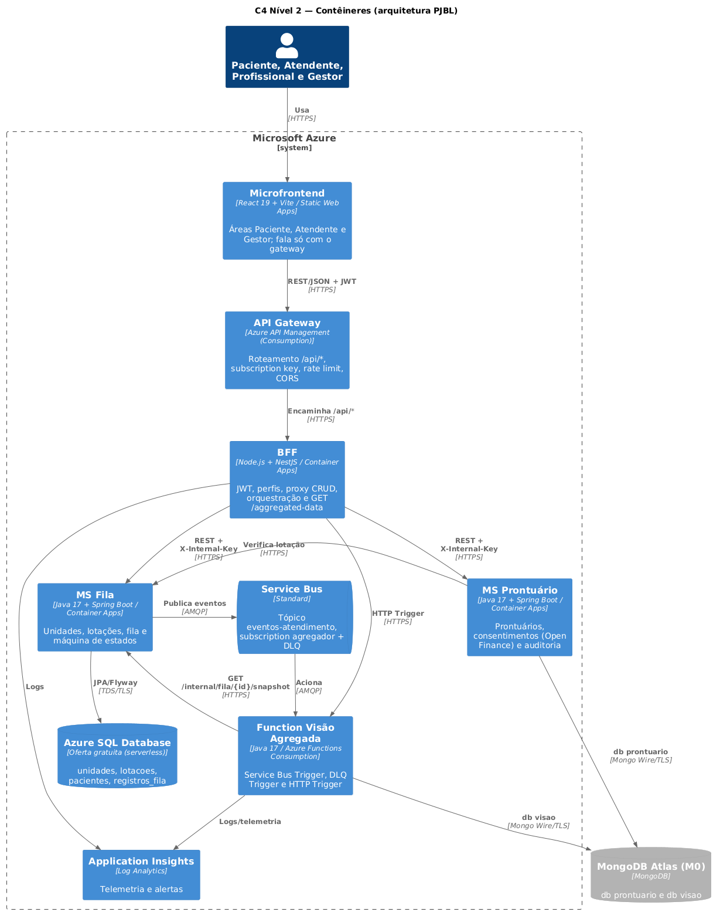

| Canal | Protocolo | Dado |
|---|---|---|
| Navegador → API Gateway | HTTPS + JWT + subscription key | todas as operações da SPA |
| API Gateway → BFF | HTTPS | `/api/*` |
| BFF → MS Fila / MS Prontuário / Function | HTTPS + `X-Internal-Key`, `X-User-*`, `X-Correlation-Id` | proxy, orquestração e agregação |
| MS Fila → Service Bus | AMQP | `EventoFilaMessage` (sem dados pessoais) |
| Service Bus → Function | AMQP | subscription `agregador` e sua DLQ |
| Function → MS Fila | HTTPS | snapshot da fila da unidade |
| MS Prontuário → MS Fila | HTTPS | verificação de lotação |
| MS Fila → Azure SQL | TDS/TLS | unidades, lotações, pacientes, fila |
| MS Prontuário, Function → Atlas | Mongo Wire/TLS | prontuários, consentimentos, auditoria / visão agregada |

\newpage

# 4. Estratégia de Solução

1. **Decomposição por capacidade de negócio e por tipo de dado**: a fila (transacional, relacional, com restrição de unicidade) vai para o Azure SQL; prontuário, consentimento e auditoria (documentos heterogêneos, append-only) vão para o MongoDB.
2. **BFF como única porta do front**: autenticação, autorização por perfil, orquestração (aviso de chegada + consentimento) e agregação (`/aggregated-data`) ficam fora dos microserviços.
3. **Event-driven para indicadores**: o MS Fila publica um evento a cada transição; a Function recalcula a visão agregada a partir do estado (idempotente), sem acoplar a operação ao cálculo.
4. **Clean Architecture + Vertical Slice em todos os componentes**, com a regra de dependência verificada por testes.

## 4.1 Clean Architecture + Vertical Slice

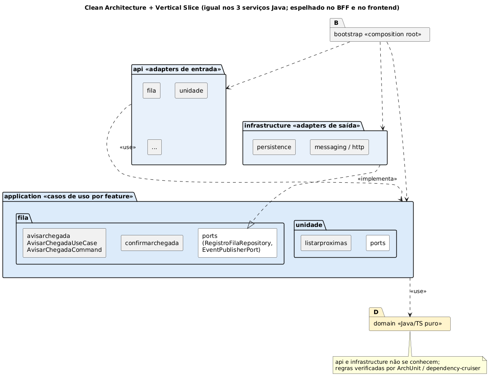

| Camada | Conteúdo | Pode depender de |
|---|---|---|
| `domain` | Entidades, enums, políticas, eventos e exceções — código puro, sem framework | só a linguagem |
| `application` | Um pacote por **feature** e, dentro dele, um por **caso de uso** (`fila/avisarchegada/AvisarChegadaUseCase`, `...Command`) + `ports` (interfaces de saída) | `domain` |
| `infrastructure` | Adapters de saída: JPA/Mongo, Service Bus, HTTP para outros serviços, JWT | `application`, `domain`, frameworks |
| `api` | Adapters de entrada: controllers REST, gatilhos da Function, filtros, tratamento de erros | `application`, `domain`, frameworks |
| `bootstrap` | Composition root: instancia casos de uso e adapters | todas |

`api` e `infrastructure` **não se conhecem**; casos de uso não têm anotações de framework e são testados com *fakes* das portas.

## 4.2 Objetivos de qualidade × abordagens

| Objetivo | Abordagem |
|---|---|
| Privacidade | Consentimento por unidade com prazo; auditoria fail-closed; eventos sem dados pessoais; `X-Internal-Key` entre serviços; erros sem dados clínicos |
| Desempenho | Indicadores assíncronos; chamadas do BFF em paralelo |
| Disponibilidade | Degradação graciosa no BFF; reentrega + DLQ no Service Bus |
| Usabilidade | `/aggregated-data` entrega a tela do atendente em uma chamada; polling de 5 s |
| Economicidade | Tiers gratuitos/consumo; escala a zero |
| Manutenibilidade | Camadas e slices verificados por ArchUnit/dependency-cruiser; testes de contrato |

\newpage

# 5. Visão de Blocos de Construção

## 5.1 Visão geral (caixa branca)

O nível 1 da decomposição é o C4 Nível 2 da seção 3.2.

| Bloco | Repositório | Responsabilidade | RFs |
|---|---|---|---|
| Microfrontend | `open-prontuario-frontend` | SPA React com áreas Paciente, Atendente e Gestor | RF01–RF16, RF18 (UI) |
| API Gateway | `open-prontuario-platform/infra` | Entrada única, rate limit, CORS | — |
| BFF | `open-prontuario-bff` | Auth, perfis, proxy, orquestração, agregação | RF01, RF02, RF07–RF09, RF18 |
| MS Fila | `open-prontuario-ms-fila-sql` | Unidades, lotações, fila, eventos | RF02, RF03, RF04, RF07–RF11, RF13, RF14, RF17 (publicação) |
| MS Prontuário | `open-prontuario-ms-prontuario-mongo` | Prontuário, consentimento, auditoria | RF05, RF06, RF12, RF15, RF16 |
| Function | `open-prontuario-fn-visao-agregada` | Visão agregada (eventos, DLQ, HTTP) | RF17, RF18 |
| Service Bus | `open-prontuario-platform/infra` | Tópico, subscription e DLQ | RF17 |

## 5.2 Nível 2 — C4 Nível 3 (componentes)

### BFF

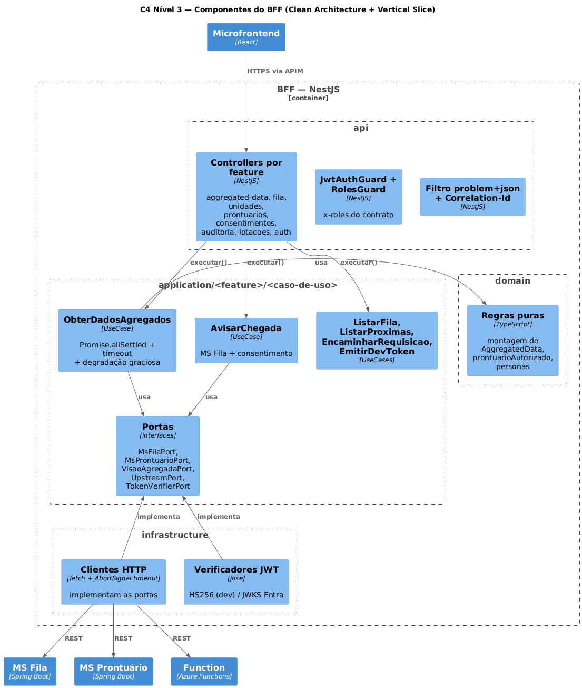

### MS Fila (Azure SQL)

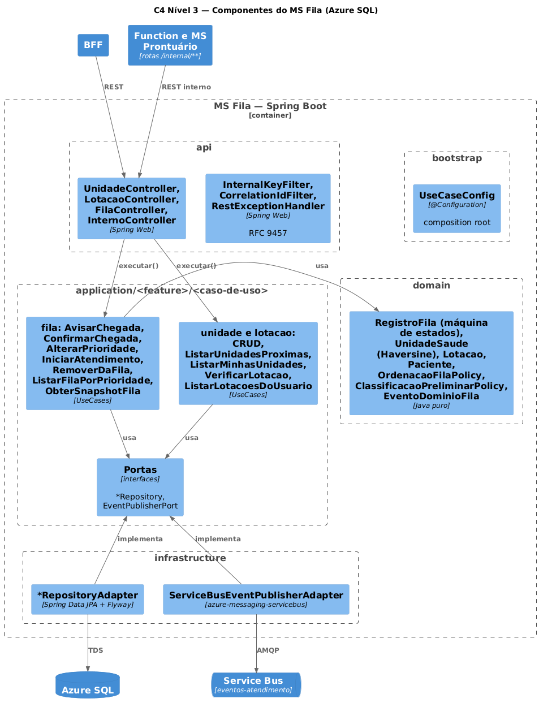

### MS Prontuário (MongoDB)

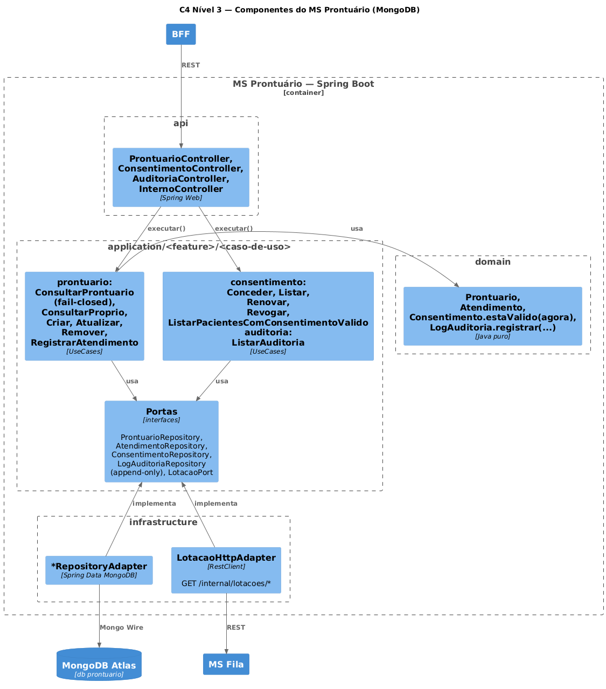

### Function Visão Agregada

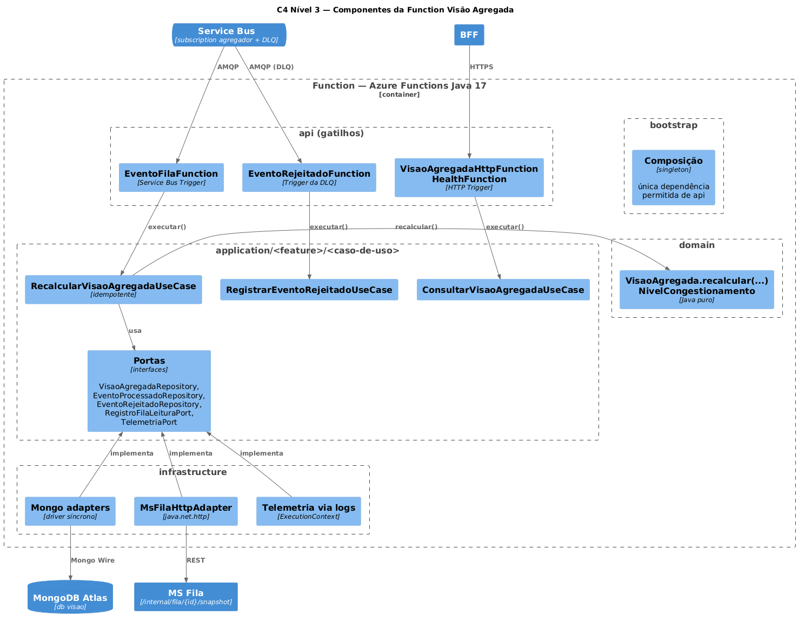

A Function é instanciada pelo runtime do Azure Functions (construtor sem argumentos), por isso os gatilhos em `api` obtêm os casos de uso de uma composição em `bootstrap`. Essa é a única dependência `api → bootstrap` permitida, registrada como exceção explícita no teste ArchUnit.

## 5.3 Nível 3 — Código

A estrutura detalhada de pacotes, classes e testes de cada componente está no README do respectivo repositório. Contratos:

| Contrato | Arquivo |
|---|---|
| Convenções compartilhadas (headers, erros, env, seed, regras) | `docs/contracts/CONVENCOES.md` |
| OpenAPI do BFF | `docs/contracts/bff.openapi.yaml` |
| OpenAPI do MS Fila | `docs/contracts/ms-fila-sql.openapi.yaml` |
| OpenAPI do MS Prontuário | `docs/contracts/ms-prontuario-mongo.openapi.yaml` |
| OpenAPI do HTTP Trigger da Function | `docs/contracts/fn-visao-agregada.openapi.yaml` |
| AsyncAPI dos eventos | `docs/contracts/asyncapi.yaml` |

Cada serviço tem um **teste de contrato** que compara as rotas implementadas com o arquivo acima.

\newpage

# 6. Visão de Tempo de Execução

## 6.1 `GET /aggregated-data` (endpoint obrigatório do PJBL)

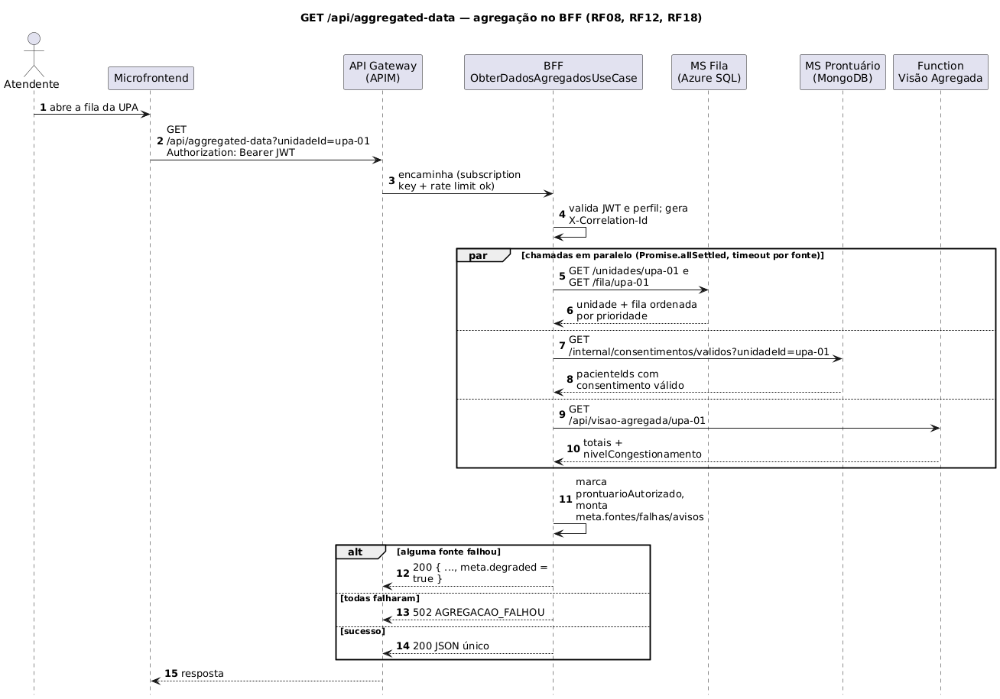

Exemplo de resposta (abreviado):

```json
{
  "unidade": { "id": "upa-01", "nome": "UPA Boa Vista", "tipo": "UPA" },
  "fila": [{ "id": "…", "pacienteNome": "João Pereira", "prioridade": "MUITO_URGENTE",
             "status": "AGUARDANDO", "prontuarioAutorizado": true }],
  "visaoAgregada": { "totalPresente": 1, "totalACaminho": 0, "tempoMedioEsperaMin": 0,
                     "nivelCongestionamento": "BAIXO" },
  "prontuario": null,
  "meta": { "correlationId": "…", "degraded": false,
            "fontes": [{ "nome": "ms-fila-sql", "status": "ok", "duracaoMs": 42 },
                       { "nome": "ms-prontuario-mongo", "status": "ok", "duracaoMs": 18 },
                       { "nome": "fn-visao-agregada", "status": "ok", "duracaoMs": 35 }],
            "falhas": [], "avisos": [] }
}
```

## 6.2 Aviso de chegada, evento e recálculo assíncrono

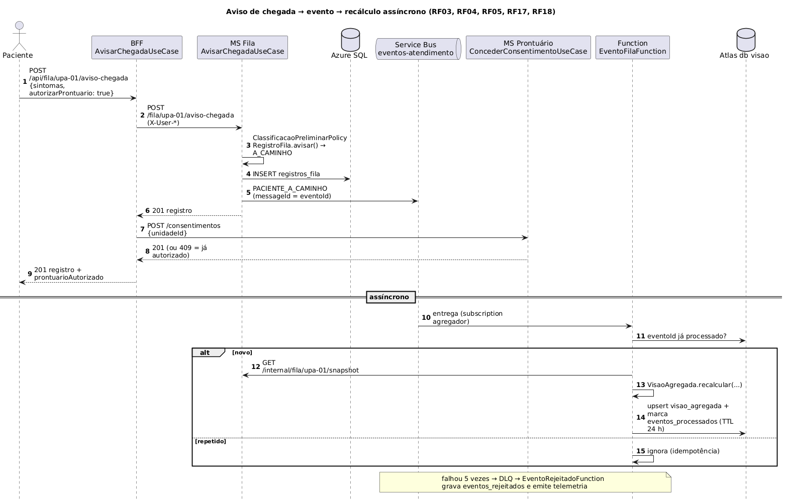

## 6.3 Consulta ao prontuário (consentimento + auditoria fail-closed)

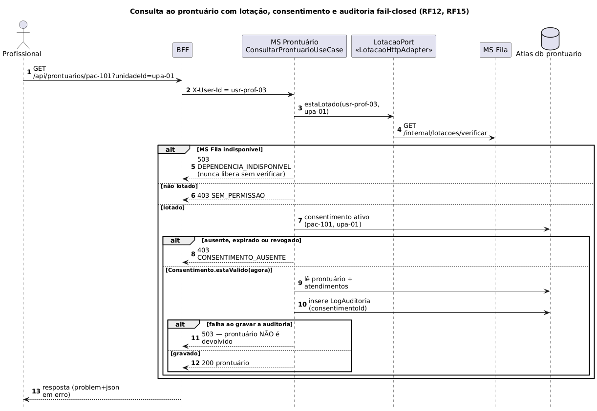

## 6.4 Ciclo de vida do registro na fila

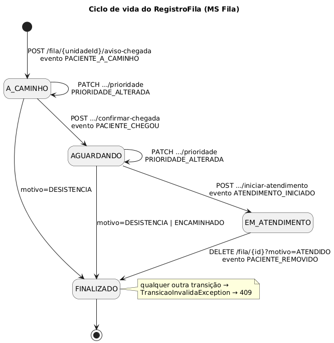

## 6.5 Evento rejeitado

Uma mensagem que falha 5 vezes (JSON inválido ou MS Fila indisponível) vai para `eventos-atendimento/Subscriptions/agregador/$DeadLetterQueue`. `EventoRejeitadoFunction` grava o corpo, o motivo e o `correlationId` em `eventos_rejeitados` e emite o log de telemetria `EventoRejeitado`, usado para alerta no Application Insights. Como a visão é recalculada a partir do estado, o próximo evento válido da unidade corrige os indicadores.

\newpage

# 7. Visão de Implantação

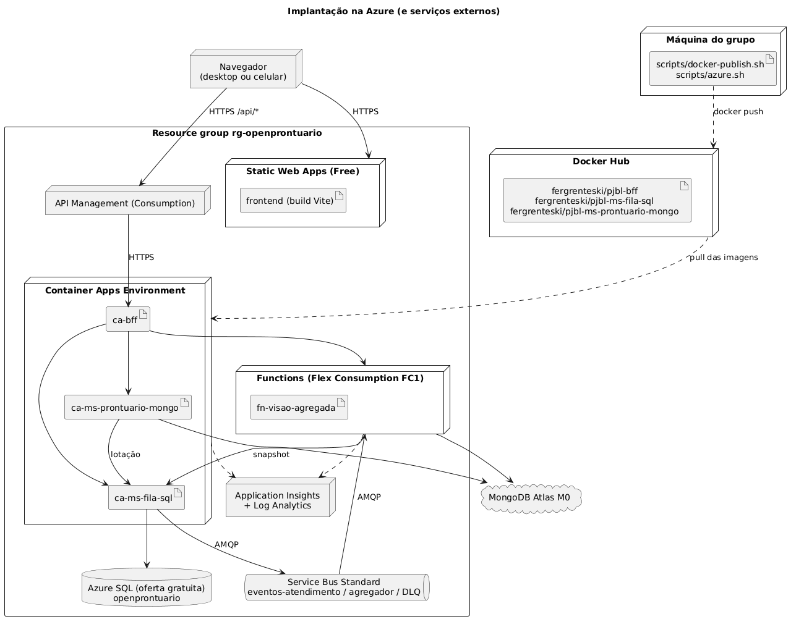

| Bloco | Serviço | Tier | Artefato |
|---|---|---|---|
| Microfrontend | Azure Static Web Apps | Free | build Vite |
| API Gateway | Azure API Management | Consumption | política de CORS + rate limit |
| BFF | Azure Container Apps | Consumption, escala 0–3 | `<usuario>/pjbl-bff` |
| MS Fila | Azure Container Apps | Consumption, escala 0–3 | `<usuario>/pjbl-ms-fila-sql` |
| MS Prontuário | Azure Container Apps | Consumption, escala 0–3 | `<usuario>/pjbl-ms-prontuario-mongo` |
| Function | Azure Functions | Flex Consumption (FC1), Java 17 | pacote `fn-visao-agregada` |
| Mensageria | Azure Service Bus | Standard (tópicos) | `eventos-atendimento` |
| Banco relacional | Azure SQL Database | oferta gratuita (serverless, auto-pause) | `openprontuario` |
| Banco de documentos | MongoDB Atlas | M0 (free) | dbs `prontuario` e `visao` |
| Observabilidade | Application Insights + Log Analytics | limite diário de 1 GB | — |

Toda a infraestrutura Azure é provisionada por `infra/bicep/main.bicep`. Localmente, `compose.yml` sobe a mesma topologia com SQL Server, Service Bus Emulator, MongoDB e Azurite.

\newpage

# 8. Conceitos Transversais

## 8.1 Modelo de dados

**Azure SQL (MS Fila)**

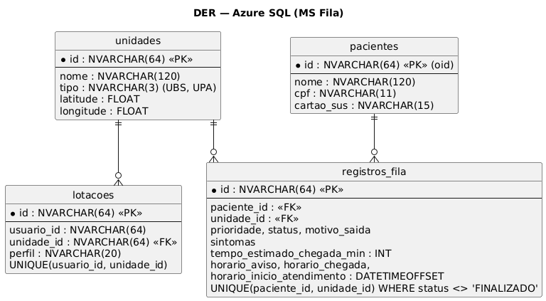

O índice único filtrado `(paciente_id, unidade_id) WHERE status <> 'FINALIZADO'` garante no banco a regra "um registro ativo por paciente e unidade".

**MongoDB (MS Prontuário — db `prontuario`; Function — db `visao`)**

| Coleção | Dono | Índices | Observação |
|---|---|---|---|
| `prontuarios` | MS Prontuário | `pacienteId` único | alergias e medicações como arrays |
| `atendimentos` | MS Prontuário | (`prontuarioId`, `data`) | histórico clínico |
| `consentimentos` | MS Prontuário | (`pacienteId`, `unidadeId`, `ativo`) | `concedidoEm`, `expiraEm`, `revogadoEm` |
| `auditoria` | MS Prontuário | (`prontuarioId`, `acessadoEm`) | **append-only** (a porta não tem update/delete) |
| `visao_agregada` | Function | `unidadeId` | upsert a cada evento |
| `eventos_processados` | Function | TTL 24 h | idempotência |
| `eventos_rejeitados` | Function | — | mensagens da DLQ |

Não há chave estrangeira entre bancos: os identificadores (`unidadeId`, `pacienteId`) são referências mantidas pela aplicação.

## 8.2 Autenticação e autorização

- O **BFF** é o único que valida JWT: modo `entra` (JWKS do Microsoft Entra ID, claims `oid`, `name`, `roles`) ou modo `dev` (HS256 com personas do seed, usado na demonstração; em produção só sobe com opt-in explícito `ALLOW_DEV_AUTH_IN_PRODUCTION=true`).
- O BFF aplica os perfis por rota (`x-roles` do contrato) e repassa `X-User-Id`, `X-User-Roles`, `X-User-Name` e `X-Internal-Key`.
- Os serviços rejeitam chamadas sem `X-Internal-Key` e aplicam as regras que dependem da identidade (lotação, titularidade, consentimento).
- O gateway exige a subscription key (identificação do cliente para rate limit), não substitui o JWT.

## 8.3 Consentimento (Open Finance) e LGPD

| Princípio | Aplicação |
|---|---|
| Específico | Por unidade; não existe consentimento genérico |
| Prazo | Padrão 3 dias, 1 a 365; `estaValido(agora)` exige ativo, não revogado e não expirado |
| Revogável | `DELETE /consentimentos/{id}` com efeito na requisição seguinte |
| Transparência | Paciente vê consentimentos e quem acessou o prontuário |
| Rastreabilidade | Cada `LogAuditoria` referencia o `consentimentoId` |

Minimização: eventos não carregam nome, CPF, sintomas nem `pacienteId`; o mapa usa só a localização no navegador. Segurança: TLS, segredos em variáveis de ambiente/secrets, auditoria fail-closed.

## 8.4 Eventos, idempotência e consistência

Os cinco eventos e o contrato da mensagem estão em `docs/contracts/asyncapi.yaml`. O MS Fila publica depois de salvar (falha de publicação é logada e não desfaz a operação). A Function ignora `eventoId` já processado e **recalcula a partir do estado** lido do MS Fila, então ordem e duplicatas não alteram o resultado. A visão agregada é eventualmente consistente (segundos); o painel opera sobre a fila do MS Fila, que é consistente.

## 8.5 Classificação de prioridade

`ClassificacaoPreliminarPolicy` sugere a prioridade a partir de sintomas de alerta (tabela em `CONVENCOES.md` §6); a definitiva é a do profissional (`PATCH .../prioridade`). `OrdenacaoFilaPolicy` ordena por gravidade e, no empate, pelo horário de chegada (ou de aviso).

## 8.6 Tratamento de erros

Respostas `application/problem+json` (RFC 9457) com `codigo` e `correlationId` em todos os serviços; o BFF repassa o erro do serviço. Tabela completa em `CONVENCOES.md` §4.

## 8.7 Observabilidade

`X-Correlation-Id` é gerado no BFF, propagado a todos os serviços e copiado para o `correlationId` da mensagem do Service Bus; a Function o restaura nos logs. Container Apps e Functions enviam logs ao Log Analytics/Application Insights.

## 8.8 Testes e verificação de arquitetura

| Componente | Unitários | Arquitetura | Contrato | Integração |
|---|---|---|---|---|
| MS Fila | JUnit 5, Mockito, MockMvc | ArchUnit | rotas × OpenAPI | Testcontainers (SQL Server) |
| MS Prontuário | JUnit 5, Mockito, MockMvc | ArchUnit | rotas × OpenAPI | Testcontainers (MongoDB) |
| Function | JUnit 5, Mockito | ArchUnit | `@HttpTrigger` × OpenAPI | Testcontainers (MongoDB) + servidor HTTP local |
| BFF | Jest, supertest | dependency-cruiser | Swagger × OpenAPI | servidores HTTP falsos |
| Frontend | Vitest, Testing Library | dependency-cruiser | — | — |
| Sistema | — | — | — | `scripts/e2e-smoke.mjs` contra o docker compose |

As regras de arquitetura verificam: direção das dependências entre camadas, `api` × `infrastructure` isoladas, domínio sem framework, nomes (`*UseCase`, `*Controller`, `*Adapter`), portas como interfaces e ausência de ciclos entre slices. Os resultados e a contagem de testes de cada repositório estão no relatório de verificação (`docs/VERIFICACAO.md`).

\newpage

# 9. Decisões Arquiteturais

As ADR-01 a ADR-10 da entrega anterior (em `docs/origem/`) continuam válidas onde não foram substituídas abaixo.

### ADR-11 — Monólito → microserviços com persistência poliglota
**Contexto:** o PJBL exige dois microserviços com bancos distintos (MongoDB e Azure SQL). **Decisão:** fila/unidades/lotações no Azure SQL (dados relacionais, restrição de unicidade, transições transacionais); prontuário/consentimento/auditoria no MongoDB (documentos heterogêneos, append-only). **Consequências:** autorização distribuída (o MS Prontuário consulta a lotação no MS Fila por uma porta HTTP); sem joins entre bancos.

### ADR-12 — Cosmos DB substituído por MongoDB Atlas M0 e Azure SQL (oferta gratuita)
**Decisão:** usar os tiers gratuitos exigidos pelo PJBL. **Consequência:** o Atlas fica fora da Azure (conexão TLS pela internet).

### ADR-13 — Java 17
**Decisão:** Java 17 (LTS instalado na equipe) em vez de Java 21. **Consequência:** nenhuma funcionalidade usada depende do 21; Azure Functions e Container Apps suportam 17.

### ADR-14 — Camadas `domain / application / infrastructure / api / bootstrap` com Vertical Slice
**Contexto:** o ADR-01 havia descartado Vertical Slice; o PJBL o exige. **Decisão:** manter as camadas da Clean Architecture e organizar `application` (e `api`) por feature e caso de uso. Adapters de entrada passam a se chamar `api` e os de saída `infrastructure`, como no enunciado. **Consequência:** regras ArchUnit/dependency-cruiser reescritas para os novos pacotes.

### ADR-15 — BFF em Node.js (NestJS) como único ponto de entrada do front
**Decisão:** autenticação, perfis, orquestração e agregação ficam no BFF; microserviços confiam em `X-Internal-Key` + `X-User-*`. **Consequência:** a SPA faz uma chamada por tela; os serviços continuam aplicando regras de identidade.

### ADR-16 — API Gateway com Azure API Management (Consumption)
**Decisão:** APIM Consumption em vez de AWS API Gateway, mantendo a solução em um único provedor. Subscription key identifica o cliente para rate limit; o JWT continua sendo validado no BFF.

### ADR-17 — App do paciente como área web da SPA
**Decisão:** substituir o React Native por uma área mobile-first na SPA, demonstrável em URL de nuvem. **Consequência:** sem acesso a recursos nativos além da geolocalização do navegador; React Native fica como evolução.

### ADR-18 — Visão agregada na Function, recalculada a partir do estado
**Decisão:** a Function lê o snapshot da fila no MS Fila a cada evento novo e grava a visão em banco próprio (db `visao`). **Consequência:** idempotência por construção; uma chamada HTTP extra por evento (aceitável no volume da demonstração).

### ADR-19 — Haversine em vez de Azure Maps
**Decisão:** distância em linha reta calculada no domínio do MS Fila. **Consequência:** sem custo nem envio de coordenadas a terceiros; distância é estimativa não vinculante.

### ADR-20 — Autenticação em dois modos (dev e Entra ID)
**Decisão:** o BFF aceita JWT do Entra ID (`AUTH_MODE=entra`) ou tokens HS256 de personas do seed (`AUTH_MODE=dev`) para a demonstração. **Consequência:** o modo dev em produção exige opt-in explícito e deve ser desligado fora do contexto acadêmico.

\newpage

# 10. Requisitos de Qualidade

## 10.1 Árvore de qualidade

| Característica | Refinamento | Cenário |
|---|---|---|
| Segurança | Sigilo | Profissional sem consentimento recebe 403 `CONSENTIMENTO_AUSENTE` |
| Segurança | Responsabilização | Toda leitura de prontuário por terceiro gera log; sem log → 503 |
| Disponibilidade | Degradação | Function fora → `/aggregated-data` 200 com `degraded = true` |
| Desempenho | Assincronia | Confirmação de chegada não espera o recálculo |
| Manutenibilidade | Conformidade arquitetural | Violação de camada quebra o build |
| Economicidade | Custo | Escala a zero e tiers gratuitos |

## 10.2 Cenários verificados

Os cenários acima são exercitados pelos testes de cada repositório e pelo smoke test E2E (`make e2e`).

\newpage

# 11. Riscos e Débitos Técnicos

| Risco / débito | Mitigação |
|---|---|
| Publicação de evento sem Transactional Outbox | Recálculo a partir do estado corrige no próximo evento; outbox como evolução |
| Cold start (escala a zero) no início da demonstração | "Aquecer" os serviços antes de gravar o vídeo; réplica mínima 1 se houver crédito |
| Modo de autenticação dev em nuvem | Opt-in explícito; usar `entra` fora da demonstração |
| Atlas fora da Azure | TLS + usuário com permissão mínima + allowlist de IPs do Container Apps/Functions |
| Custo do Service Bus Standard e do APIM | Alertas de orçamento; apagar o resource group ao fim do semestre |
| Dependência síncrona MS Prontuário → MS Fila (lotação) | Fail-closed (503); cache curto como evolução |
| SQL Server e runtime Functions sem imagem arm64 | Emulação no Docker Desktop; CI em runners x86 |

\newpage

# 12. Glossário

| Termo | Definição |
|---|---|
| BFF | Backend for Frontend: backend dedicado a um front, que agrega e adapta chamadas |
| Microfrontend | Front implantado e versionado de forma independente, consumindo só o seu BFF |
| API Gateway | Ponto de entrada único com roteamento, segurança e limites |
| Vertical Slice | Organização do código por funcionalidade (feature/caso de uso) |
| Clean Architecture | Camadas concêntricas com dependências apontando para o domínio |
| Porta / Adapter | Interface declarada na aplicação / implementação concreta na infraestrutura ou na API |
| Visão agregada | Indicadores pré-calculados por unidade (presentes, a caminho, tempo médio, nível de congestionamento) |
| DLQ | Dead-letter queue: fila de mensagens que falharam repetidamente |
| Idempotência | Reprocessar a mesma mensagem não muda o resultado |
| Consentimento | Autorização do paciente, por unidade e com prazo, para compartilhar o prontuário |
| Lotação | Vínculo de um profissional com uma unidade |
| Problem Details | Formato de erro HTTP padronizado (RFC 9457) |
| UPA / UBS | Unidade de Pronto Atendimento / Unidade Básica de Saúde (SUS) |
