```{=latex}
\begin{titlepage}
\centering
\vspace*{2.5cm}
{\Huge\bfseries Open Prontuário\par}
\vspace{0.6cm}
{\LARGE Sistema de Prontuário e Filas UBS/UPA\par}
\vspace{1.2cm}
{\Large Documentação de Arquitetura de Software\par}
\vspace{0.3cm}
{\large arc42 · C4 Model (Níveis 1 a 4) · UML · DER · Software Architecture Canvas\par}
\vspace{0.3cm}
{\large Estilo arquitetural: Clean Architecture\par}
\vfill
{\Large\bfseries Integrantes do grupo\par}
\vspace{0.5cm}
{\Large Ana Paula Alves\par Artur Bertoni\par Bernardo Plottegher\par Luiz Fernando Grenteski\par}
\vfill
{\large Outubro de 2026\par}
\end{titlepage}
\tableofcontents
\newpage
```

# Alunos {.unnumbered}

| Integrante | Papel principal no projeto |
|-----------------------------|---------------------------------------------------------------|
| Ana Paula Alves | Domínio e casos de uso de fila (API Principal) |
| Artur Bertoni | Consentimento, prontuário e auditoria (API Principal) |
| Bernardo Plottegher | Worker de Fila, mensageria e infraestrutura Azure (Bicep) |
| Luiz Fernando Grenteski | Frontends (Painel do Atendente e App do Paciente) e testes de arquitetura |

Todos os integrantes participam da documentação arc42 e da revisão de código.

## Sobre este documento {.unnumbered}

Este documento segue o template oficial do **arc42** (versão 8, disponível em <https://arc42.org/download>), mantendo a numeração e os títulos das seções do template. Os diagramas seguem o **C4 Model** (Nível 1 — Contexto, Nível 2 — Contêineres, Nível 3 — Componentes e Nível 4 — Código), sendo o Nível 4 representado por diagramas **UML** de pacotes, classes, componentes, sequência e estados. O modelo de dados é apresentado em um **Diagrama de Entidades e Relacionamentos (DER)**, e a visão executiva da arquitetura está no **Software Architecture Canvas** a seguir.

| Diagrama | Seção |
|-------------------------------------------|---------------------------------------|
| Software Architecture Canvas | Início do documento |
| C4 Nível 1 — Contexto | 3.1 |
| C4 Nível 2 — Contêineres | 3.2 (referenciado em 5.1) |
| C4 Nível 3 — Componentes | 5.2 |
| C4 Nível 4 — Pacotes, Classes e Componentes (UML) | 5.3 |
| C4 Nível 4 — Sequência e Estados (UML) | 6 |
| Implantação | 7 |
| DER | 8.1 |
| Árvore de qualidade | 10.1 |

\newpage

# Software Architecture Canvas {.unnumbered}

| Bloco | Conteúdo |
|------------------------------|------------------------------------------------------------------------------------|
| **Business Case** | Reduzir o tempo até o atendimento dos casos mais graves nas UPAs, dando ao atendente uma fila ordenada por risco clínico e acesso ao prontuário do paciente antes mesmo da chegada física, com consentimento explícito do paciente no modelo do Open Finance. |
| **Business Context** | Rede de UPAs e UBSs de um município, sob gestão da secretaria municipal de saúde (SUS), com pacientes que se deslocam por conta própria até a unidade. |
| **Functional Overview** | App do paciente (localização, UPAs próximas, aviso de chegada com sintomas, consentimento de prontuário) e Painel do Atendente (seleção de UPA, fila priorizada, confirmação de chegada, repriorização, prontuário, início e encerramento do atendimento, auditoria e indicadores). |
| **Quality Goals** | 1. Privacidade e sigilo · 2. Desempenho em picos · 3. Disponibilidade · 4. Usabilidade do atendente · 5. Economicidade · 6. Manutenibilidade |
| **Organisational Constraints** | Equipe de 4 alunos · Prazo do semestre letivo · Conta Azure for Students (crédito limitado) · LGPD |
| **Technical Constraints** | Ecossistema 100% Azure · Backend em Java 21 / Spring Boot 3 · Web em React JS · Mobile em React Native · Fila assíncrona obrigatória via Azure Service Bus · Persistência em Azure Cosmos DB (API MongoDB) · Identidade no Microsoft Entra ID |
| **Architecture Overview** | App Mobile / Painel Web → API Principal Spring Boot (Container Apps) → Service Bus → Worker de Fila (Azure Functions) → Cosmos DB. Internamente, API e Worker seguem **Clean Architecture** em quatro camadas (`domain`, `application`, `adapters`, `infrastructure`), com dependências apontando sempre para o domínio. Detalhes nas seções 3.2, 5.2 e 5.3. |
| **Architecture Hypotheses** | Mensageria assíncrona absorve picos de aviso de chegada · Cosmos DB atende dados operacionais e agregados sem segundo motor de banco · Consentimento por unidade resolve o compartilhamento de prontuário sem integração externa real · Clean Architecture permite trocar adaptadores (Azure Maps, Cosmos DB, Service Bus) sem alterar regras de negócio |
| **Technical Challenges & Risks** | Consistência eventual da visão agregada · Sigilo e auditoria de acesso ao prontuário · Dependência de serviços gerenciados Azure · Curva de aprendizado de mensageria assíncrona e de Clean Architecture · Código de mapeamento entre camadas |

\newpage

# 1. Introdução e Objetivos

## 1.1 Visão Geral dos Requisitos

### Contexto

Cada UPA gerencia sua fila de atendimento de forma isolada, e o atendente só descobre a condição do paciente quando ele chega fisicamente ao balcão. Do outro lado, o paciente não sabe qual unidade está menos congestionada e chega sem que a unidade tenha qualquer informação prévia sobre seu quadro clínico ou seu histórico.

O **Open Prontuário** ataca os dois lados. No **aplicativo do paciente** (React Native), o usuário visualiza sua localização atual e as UPAs próximas, sinaliza que está a caminho de uma unidade informando seus sintomas, e decide se compartilha ou não seu prontuário com aquela unidade — em um modelo de consentimento explícito, com prazo e revogável, inspirado no **Open Finance**. No **Painel do Atendente** (React JS), o profissional seleciona a UPA em que está lotado, visualiza a fila ordenada por prioridade (distinguindo quem já chegou de quem está a caminho), confirma a chegada dos pacientes, consulta o prontuário dos que autorizaram o compartilhamento, ajusta a prioridade conforme a triagem, inicia o atendimento e encerra o registro ao concluir.

Toda mudança de estado da fila trafega de forma **assíncrona** pelo Azure Service Bus, o que desacopla o registro operacional da recepção da atualização da visão agregada consumida pelo app e pelo painel.

### Objetivo de negócio

Antecipar informação clínica e de demanda para a unidade de saúde: permitir que a UPA saiba quem está chegando, com qual quadro e com qual histórico, antes da chegada física, e que o atendente organize a fila por prioridade real de risco em vez de ordem de chegada — reduzindo o tempo até o atendimento dos casos mais graves.

### O que o software resolve

* A ausência de informação prévia sobre quem está a caminho da unidade e com quais sintomas;
* A fragmentação do prontuário do paciente entre unidades, que hoje impede o atendente de conhecer alergias, medicações e diagnósticos anteriores;
* A organização da fila por ordem de chegada em vez de prioridade clínica;
* A falta de visibilidade, para o paciente, sobre qual unidade procurar.

### Quem são os usuários

Pacientes (app mobile), atendentes de recepção, profissionais de saúde e gestores das unidades (painel web).

### Requisitos Funcionais

| Código | Requisito Funcional |
|--------|------------------------------------------------------------------------------------------|
| RF01 | Autenticação do paciente no aplicativo mobile |
| RF02 | Visualização da localização atual do paciente e das UPAs próximas, com status de fila |
| RF03 | Sinalização de que o paciente está se dirigindo a uma UPA (aviso de chegada) |
| RF04 | Informação dos sintomas do paciente no momento do aviso de chegada |
| RF05 | Concessão e revogação, pelo paciente, do consentimento de compartilhamento do seu prontuário com uma unidade |
| RF06 | Visualização, pelo paciente, do próprio prontuário e do histórico de compartilhamentos |
| RF07 | Autenticação do atendente e seleção da UPA em que está lotado |
| RF08 | Visualização da fila da unidade, ordenada por prioridade clínica |
| RF09 | Distinção, na fila, entre pacientes presentes na unidade e pacientes a caminho |
| RF10 | Confirmação, pelo atendente, da chegada física do paciente à unidade |
| RF11 | Alteração da prioridade de um paciente na fila pelo atendente |
| RF12 | Consulta ao prontuário do paciente pelo atendente, mediante consentimento válido |
| RF13 | Início do atendimento de um paciente da fila |
| RF14 | Remoção de um paciente da fila (atendimento concluído, desistência ou encaminhamento) |
| RF15 | Registro em log de auditoria de todo acesso a prontuário compartilhado |
| RF16 | Consulta ao log de auditoria de acessos a um prontuário |
| RF17 | Processamento assíncrono, via fila de mensagens, de todos os eventos de mudança de estado da fila |
| RF18 | Manutenção e consulta da visão agregada da fila (total presente, total a caminho e tempo médio de espera) por unidade |

### Matriz de Rastreabilidade — Requisito × Endpoint × Caso de Uso

A tabela relaciona cada requisito funcional à operação correspondente na especificação OpenAPI 3.2 (`openapi_prontuario_filas.yaml`), ao controller que a expõe (camada `adapters`) e ao caso de uso que a implementa (camada `application`), garantindo que não existam requisitos sem implementação nem endpoints sem justificativa.

| RF | Método e rota (operationId) | Controller | Caso de uso |
|-----|-------------------------|--------------|----------------------|
| RF01 | OAuth2/OIDC — delegado ao Microsoft Entra ID (`securitySchemes`) | — (`SecurityConfig`) | — |
| RF02 | `GET /unidades/proximas` (`listarUnidadesProximas`) | `UnidadeController` | `ListarUnidadesProximasUseCase` |
| RF03, RF04 | `POST /fila/{unidadeId}/aviso-chegada` (`avisarChegada`) | `FilaController` | `AvisarChegadaUseCase` |
| RF05 | `POST /consentimentos` (`concederConsentimento`) | `ConsentimentoController` | `ConcederConsentimentoUseCase` |
| RF05 | `DELETE /consentimentos/{consentimentoId}` (`revogarConsentimento`) | `ConsentimentoController` | `RevogarConsentimentoUseCase` |
| RF06 | `GET /prontuarios/me` (`consultarProprioProntuario`) | `ProntuarioController` | `ConsultarProprioProntuarioUseCase` |
| RF06 | `GET /consentimentos` (`listarConsentimentos`) | `ConsentimentoController` | `ListarConsentimentosUseCase` |
| RF07 | `GET /unidades/minhas` (`listarMinhasUnidades`) | `UnidadeController` | `ListarMinhasUnidadesUseCase` |
| RF08, RF09 | `GET /fila/{unidadeId}` (`listarFilaPorPrioridade`) | `FilaController` | `ListarFilaPorPrioridadeUseCase` |
| RF10 | `POST /fila/{registroId}/confirmar-chegada` (`confirmarChegada`) | `FilaController` | `ConfirmarChegadaUseCase` |
| RF11 | `PATCH /fila/{registroId}/prioridade` (`alterarPrioridade`) | `FilaController` | `AlterarPrioridadeUseCase` |
| RF12, RF15 | `GET /prontuarios/{pacienteId}` (`consultarProntuario`) | `ProntuarioController` | `ConsultarProntuarioUseCase` |
| RF13 | `POST /fila/{registroId}/iniciar-atendimento` (`iniciarAtendimento`) | `FilaController` | `IniciarAtendimentoUseCase` |
| RF14 | `DELETE /fila/{registroId}` (`removerDaFila`) | `FilaController` | `RemoverDaFilaUseCase` |
| RF16 | `GET /auditoria/prontuarios/{prontuarioId}` (`listarAuditoriaProntuario`) | `AuditoriaController` | `ListarAuditoriaUseCase` |
| RF17 | AMQP — tópico `eventos-atendimento` (seções 6 e 8) | `EventoFilaFunction` (Worker) | `RecalcularVisaoAgregadaUseCase` (Worker) |
| RF18 | `GET /unidades/{unidadeId}/visao-agregada` (`consultarVisaoAgregada`) | `UnidadeController` | `ConsultarVisaoAgregadaUseCase` (leitura) e `RecalcularVisaoAgregadaUseCase` (manutenção) |

Além dos casos de uso acima, o Worker possui o caso de uso `RegistrarEventoRejeitadoUseCase`, que trata as mensagens enviadas à dead-letter queue (RF17).

## 1.2 Objetivos de Qualidade

| Prioridade | Objetivo de Qualidade | Cenário |
|------------|-------------------------------|----------------------------------------------------------------------------------|
| 1 | **Privacidade e sigilo** | Um prontuário só pode ser exibido ao atendente se existir consentimento válido e não revogado do paciente para aquela unidade, e todo acesso fica registrado. |
| 2 | **Desempenho / Escalabilidade** | Em horário de pico, com múltiplas UPAs recebendo avisos de chegada simultâneos, o painel do atendente continua respondendo sem degradação perceptível. |
| 3 | **Disponibilidade** | O painel do atendente e o registro de pacientes não podem ficar indisponíveis durante o horário de funcionamento da unidade. |
| 4 | **Usabilidade** | O atendente deve conseguir confirmar chegada, alterar prioridade ou encerrar um registro em poucos cliques, sem recarregar a tela. |
| 5 | **Economicidade** | A solução opera dentro do crédito de uma conta Azure for Students, priorizando serviços de tier gratuito e planos de consumo. |
| 6 | **Manutenibilidade** | As regras de negócio ficam isoladas no domínio e nos casos de uso; a regra de dependência da Clean Architecture é verificada automaticamente por testes ArchUnit a cada build. |

## 1.3 Partes Interessadas

| Função/Nome | Contato | Expectativas |
|-----------------------------|----------------------------------|----------------------------------------------------------|
| Paciente | Aplicativo mobile (React Native) | Saber para qual UPA ir, avisar que está a caminho e controlar quem vê seu prontuário |
| Atendente / Recepção | Painel web (React JS) | Ver a fila priorizada por risco e organizar o atendimento com poucos cliques |
| Profissional de saúde | Painel web (React JS) | Acessar o prontuário do paciente autorizado antes ou durante o atendimento |
| Gestor da unidade | Painel web (React JS) | Acompanhar o volume de demanda, o tempo médio de espera e a auditoria de acessos |
| Secretaria municipal de saúde | Gestão da rede SUS | Conformidade com a LGPD e redução do tempo de espera dos casos graves |
| Professor / avaliador da disciplina | Ambiente virtual de aprendizagem | Documentação arc42 completa, coerente e com diagramas legíveis |
| Equipe de desenvolvimento — Ana Paula Alves | Integrante do grupo | Entregar o domínio e os casos de uso de fila |
| Equipe de desenvolvimento — Artur Bertoni | Integrante do grupo | Entregar consentimento, prontuário e auditoria |
| Equipe de desenvolvimento — Bernardo Plottegher | Integrante do grupo | Entregar Worker, mensageria e infraestrutura |
| Equipe de desenvolvimento — Luiz Fernando Grenteski | Integrante do grupo | Entregar frontends e testes de arquitetura |

\newpage

# 2. Restrições Arquiteturais

| Tipo | Restrição | Explicação |
|----------------|--------------------------------------|--------------------------------------------------------------------------|
| Técnica | Ecossistema Microsoft Azure | Toda a infraestrutura (hospedagem, mensageria, dados, identidade, observabilidade) é construída sobre serviços gerenciados da Azure, provisionados com Bicep. |
| Técnica | Backend em Spring Boot (Java) | A API Principal e o Worker de Fila são implementados em Java 21 com Spring Boot 3 (o Worker usa Spring Cloud Function sobre Azure Functions). |
| Técnica | Frontend web em React JS | O Painel do Atendente é uma SPA em React JS. |
| Técnica | Aplicativo mobile em React Native | O app do paciente é multiplataforma (Android/iOS) e executa no dispositivo do usuário, fora da fronteira da nuvem. |
| Técnica | Fila assíncrona obrigatória | Todos os eventos de mudança de estado da fila trafegam pelo **Azure Service Bus**, com dead-letter queue para falhas. |
| Técnica | Persistência em Azure Cosmos DB (API MongoDB) | Banco de documentos único para dados operacionais, prontuários, consentimentos, auditoria e visão agregada. |
| Técnica | Autenticação federada | O acesso de pacientes e profissionais passa pelo **Microsoft Entra ID**, via OAuth2/OIDC. |
| Técnica | Clean Architecture | API e Worker são organizados nas camadas `domain`, `application`, `adapters` e `infrastructure`; a regra de dependência é verificada por testes ArchUnit no pipeline de CI. |
| Organizacional | Conta Azure for Students | Crédito limitado; a arquitetura prioriza tiers gratuitos e planos de consumo. |
| Organizacional | Sigilo de dados de saúde (LGPD) | O acesso ao prontuário exige consentimento explícito do paciente e é integralmente auditado. |
| Organizacional | Equipe fixa de 4 integrantes | O desenvolvimento e a documentação são conduzidos pela mesma equipe ao longo de todas as atividades. |
| Organizacional | Prazo do semestre letivo | O escopo prioriza os requisitos RF01 a RF18; integrações com sistemas nacionais (RNDS, HL7 FHIR) ficam como evolução futura. |

\newpage

# 3. Contexto e Escopo

## 3.1 Contexto Negocial

O diagrama a seguir corresponde ao **C4 Nível 1 — Diagrama de Contexto**. O Open Prontuário é a única caixa interna; Azure Maps e Microsoft Entra ID são sistemas externos consumidos como serviço.

<!-- fig: c4-n1-contexto | C4 Nível 1 — Diagrama de Contexto do Open Prontuário -->
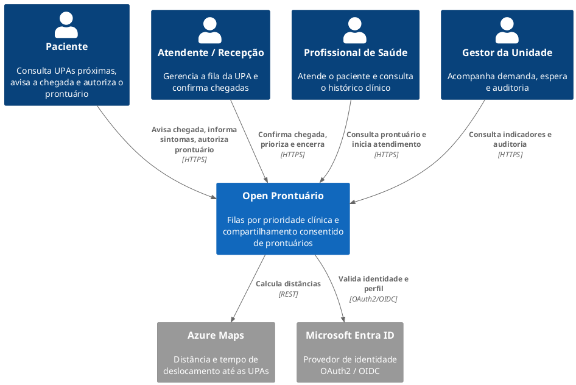

### Explicação das interfaces de domínio externo

| Componente externo | Entradas (para o sistema) | Saídas (do sistema) |
|-------------------------|------------------------------------------------|-----------------------------------------------|
| Paciente | Localização, sintomas, aviso de chegada, consentimento de prontuário | Lista de UPAs próximas com status de fila, posição na fila, próprio prontuário e histórico de compartilhamentos |
| Atendente / Recepção | Seleção da UPA, confirmação de chegada, alteração de prioridade, encerramento do registro | Fila ordenada por prioridade, prontuário autorizado |
| Profissional de Saúde | Solicitação de consulta ao prontuário, início do atendimento | Histórico clínico consolidado do paciente |
| Gestor da Unidade | Solicitação de indicadores e de auditoria | Visão agregada (total presente, total a caminho, tempo médio de espera) e log de acessos |
| Azure Maps | Coordenadas do paciente e das unidades | Distância e tempo estimado de deslocamento |
| Microsoft Entra ID | Credenciais / token | Identidade (`oid`) e perfil (`roles`) validados |

## 3.2 Contexto Técnico

O diagrama a seguir corresponde ao **C4 Nível 2 — Diagrama de Contêineres**. O **App do Paciente executa no dispositivo do usuário**, fora da fronteira da nuvem, e **Azure Maps e Microsoft Entra ID são sistemas externos** (SaaS consumidos pela equipe, não contêineres implantados por ela) — coerente com sua representação no Nível 1.

<!-- fig: c4-n2-conteineres | C4 Nível 2 — Diagrama de Contêineres do Open Prontuário na Azure -->
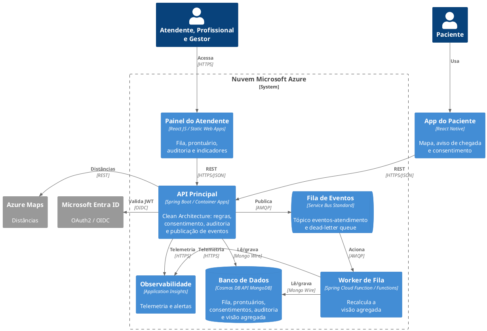

### Mapeamento de entrada/saída para canais

| Canal técnico | Protocolo | Dado de domínio transportado |
|-------------------------------------|---------------------|------------------------------------------------------|
| App Mobile → API Principal | HTTPS/JSON | Aviso de chegada, sintomas, consentimento, consulta ao próprio prontuário |
| Painel Web → API Principal | HTTPS/JSON | Seleção de UPA, confirmação de chegada, prioridade, início e encerramento do atendimento, prontuário, auditoria, visão agregada |
| App Mobile / Painel Web → Entra ID | OIDC (MSAL) | Login e obtenção do token de acesso |
| API Principal → Entra ID | OAuth2/OIDC | Validação da assinatura do JWT (chaves JWKS), `oid` e `roles` |
| API Principal → Service Bus | AMQP | Eventos de fila (a caminho, chegou, priorização, início, remoção) |
| Service Bus → Worker de Fila | AMQP | Consumo assíncrono dos eventos pela subscription `agregador` |
| Worker de Fila → Cosmos DB | Mongo Wire Protocol | Leitura dos registros ativos da unidade e gravação da visão agregada |
| API Principal → Cosmos DB | Mongo Wire Protocol | Pacientes, unidades, lotações, fila, prontuários, consentimentos, auditoria |
| API Principal → Azure Maps | REST/HTTPS | Coordenadas, distância e tempo de deslocamento |
| API e Worker → Application Insights | HTTPS | Telemetria de execução, latência, erros e `correlationId` |

\newpage

# 4. Estratégia de Solução

A arquitetura combina dois níveis de decisão:

1. **No nível de sistema**, um modelo **orientado a eventos com separação entre escrita operacional e leitura agregada**: a API Principal atende as requisições síncronas (fila, prontuário, consentimento), enquanto toda mudança de estado da fila é publicada como evento no Azure Service Bus e processada de forma assíncrona pelo Worker de Fila, que mantém a visão agregada por unidade.
2. **No nível de código**, a **Clean Architecture**, aplicada igualmente à API Principal e ao Worker de Fila.

## 4.1 Como a Clean Architecture está aplicada

Cada aplicação Java é dividida em quatro camadas concêntricas. A **regra de dependência** determina que o código de uma camada só pode depender de camadas mais internas: `infrastructure → adapters → application → domain`.

| Camada | Pacote | Conteúdo | Pode depender de |
|----------------|-----------------------------------|---------------------------------------------------|-----------------------|
| Domínio | `br.com.openprontuario.api.domain` | Entidades (`RegistroFila`, `Consentimento`, `Prontuario`...), enumerados, políticas (`OrdenacaoFilaPolicy`, `ClassificacaoPreliminarPolicy`), evento `EventoDominioFila` e exceções de negócio. Java puro, sem Spring nem SDKs. | Somente `java.*` |
| Aplicação | `...api.application` | Casos de uso (`*UseCase`), comandos e resultados (`dto`) e **portas de saída** (`*Repository`, `*Port`), que são interfaces. | `domain` e `java.*` |
| Adaptadores | `...api.adapters` | Entrada: controllers REST (`adapters.in.web`). Saída: implementações das portas (`*Adapter`) para Cosmos DB, Service Bus e Azure Maps. | `application`, `domain`, frameworks |
| Infraestrutura | `...api.infrastructure` | Composição (`UseCaseConfig` instancia os casos de uso com `@Bean`), segurança Entra ID, clientes dos SDKs Azure, `CorrelationIdFilter` e telemetria. | Todas as camadas |

Consequências práticas desta organização:

* **Inversão de dependência**: os casos de uso dependem de interfaces (portas) declaradas na camada `application`; as implementações concretas ficam em `adapters.out` e são injetadas pela camada `infrastructure`. Trocar o Azure Maps por outro provedor exige apenas um novo `GeolocalizacaoPort`.
* **Casos de uso sem framework**: as classes `*UseCase` não usam anotações do Spring; são instanciadas em `UseCaseConfig`. Isso permite testá-las com JUnit puro e *fakes* das portas, sem subir contexto Spring nem Cosmos DB.
* **Regras de negócio no domínio**: as transições da máquina de estados (seção 6.11) são métodos de `RegistroFila`, e a validade do consentimento é decidida por `Consentimento.estaValido(agora)`. Controllers e adapters não contêm regra de negócio.
* **Verificação automática**: os testes ArchUnit da seção 8.8 falham o build se alguma dependência violar a regra.

## 4.2 Decisões estruturantes

* **Spring Boot em Azure Container Apps** para a API Principal, que precisa estar sempre disponível para o app e o painel e concentra as regras de negócio (ADR-02).
* **Worker em Azure Functions** acionado por gatilho do Service Bus, cobrado por execução — adequado a um processo que só reage a eventos (ADR-03).
* **Azure Service Bus** como espinha dorsal do desacoplamento: o atendente registra a mudança e recebe confirmação imediata, sem esperar o recálculo da visão agregada (ADR-05).
* **Azure Cosmos DB (API MongoDB)** como banco único, com coleções distintas por agregado; o schema flexível acomoda prontuários e listas de sintomas heterogêneos (ADR-04).
* **Consentimento como entidade de primeira classe**, no estilo Open Finance: concedido por unidade, com prazo de validade, revogável a qualquer momento e auditado (ADR-07).
* **Dois frontends para dois contextos de uso**: React Native para a mobilidade do paciente, React JS para a operação de balcão (ADR-08).
* **Testes de arquitetura com ArchUnit** executados a cada build, transformando a regra de dependência em verificação automática (ADR-10).

## 4.3 Relação entre objetivos de qualidade e abordagens

| Objetivo de qualidade | Abordagem da solução |
|---------------------------|--------------------------------------------------------------------------------|
| Privacidade e sigilo | `ConsultarProntuarioUseCase` valida lotação e consentimento antes de ler o prontuário e grava `LogAuditoria` de forma síncrona (*fail-closed*) |
| Desempenho | Confirmação imediata ao usuário; agregação assíncrona pelo Worker; leitura da visão agregada pré-calculada |
| Disponibilidade | Réplica mínima da API no horário de funcionamento; eventos retidos no Service Bus se o Worker falhar; DLQ |
| Usabilidade | Painel com ações de um clique e atualização periódica da fila sem recarregar a página |
| Economicidade | Static Web Apps Free, Functions Consumption, Cosmos DB Free Tier, Container Apps com escala a zero fora do expediente |
| Manutenibilidade | Clean Architecture, casos de uso testáveis sem framework e regras ArchUnit no CI |

\newpage

# 5. Visão de Blocos de Construção

## 5.1 Visão Sistêmica Geral de Caixa Branca

***Diagrama de Visão Geral***

O diagrama de visão geral é o **C4 Nível 2 — Diagrama de Contêineres** apresentado na seção 3.2 (Figura 2).

Motivação
:   O sistema se divide em dois frontends especializados por persona, uma API central com as regras de negócio, um worker assíncrono, uma fila de eventos e um banco de documentos compartilhado. Dentro da API e do Worker, a Clean Architecture separa regras de negócio de detalhes técnicos.

Blocos de Construção Contidos
:   App do Paciente, Painel do Atendente, API Principal, Fila de Eventos, Worker de Fila, Banco de Dados, Observabilidade.

Interfaces Importantes
:   HTTPS/JSON entre frontends e API Principal (contrato OpenAPI 3.2); AMQP entre API Principal, Service Bus e Worker (contrato de mensagem na seção 8.4); Mongo Wire Protocol entre backend e Cosmos DB.

### App do Paciente

*Propósito/Responsabilidade:* aplicativo React Native, executado no dispositivo do usuário, que exibe a localização atual e as UPAs próximas, permite o aviso de chegada com sintomas e dá ao paciente o controle sobre o compartilhamento do seu prontuário. Telas: `TelaMapa`, `TelaAvisoChegada`, `TelaConsentimento`, `TelaMeuProntuario`.

*Interface(s):* HTTPS/JSON com a API Principal; OIDC com o Entra ID (MSAL); API de geolocalização do dispositivo.

*Requisitos Cumpridos:* RF01 a RF06.

### Painel do Atendente

*Propósito/Responsabilidade:* SPA em React JS que apresenta a fila da UPA selecionada, ordenada por prioridade, permitindo confirmar chegada, alterar prioridade, consultar prontuário autorizado, iniciar atendimento, encerrar registros, consultar a auditoria e os indicadores da unidade. Telas: `TelaSelecaoUnidade`, `TelaFila`, `TelaProntuario`, `TelaAuditoria`, `TelaIndicadores`.

*Interface(s):* HTTPS/JSON com a API Principal; OIDC com o Entra ID (MSAL).

*Requisitos Cumpridos:* RF07 a RF14, RF16, RF18.

### API Principal

*Propósito/Responsabilidade:* aplicação Spring Boot organizada em Clean Architecture que concentra as regras de negócio — ordenação por prioridade, transição de estados da fila, validação de consentimento, registro de auditoria — e publica os eventos de fila no Service Bus.

*Interface(s):* REST/JSON (entrada), AMQP (publicação), Mongo Wire Protocol (persistência), REST (Azure Maps), OIDC (Entra ID).

*Requisitos Cumpridos:* RF02 a RF16, RF18 (consulta).

### Fila de Eventos

*Propósito/Responsabilidade:* tópico `eventos-atendimento` do Azure Service Bus que transporta os cinco eventos de domínio (`PacienteACaminho`, `PacienteChegou`, `PrioridadeAlterada`, `AtendimentoIniciado`, `PacienteRemovido`), com detecção de duplicatas, subscription `agregador` e dead-letter queue para mensagens que falharem no processamento.

*Requisitos Cumpridos:* RF17.

### Worker de Fila

*Propósito/Responsabilidade:* aplicação Spring Cloud Function em Azure Functions, também em Clean Architecture, que consome os eventos e recalcula a visão agregada de cada unidade (total presente, total a caminho e tempo médio de espera), além de tratar as mensagens enviadas à dead-letter queue.

*Interface(s):* AMQP (consumo), Mongo Wire Protocol (leitura e gravação), HTTPS (telemetria).

*Requisitos Cumpridos:* RF17 e RF18 (manutenção).

### Banco de Dados

*Propósito/Responsabilidade:* Azure Cosmos DB com API MongoDB, armazenando pacientes, unidades, lotações, registros de fila, prontuários, atendimentos, consentimentos, logs de auditoria, visão agregada e o controle de eventos processados (seção 8.1).

*Interface(s):* Mongo Wire Protocol (TLS).

*Requisitos Cumpridos:* suporte a todos os requisitos que persistem dados (RF02 a RF18).

### Observabilidade

*Propósito/Responsabilidade:* Application Insights recebendo telemetria da API e do Worker, com correlação por `correlationId` e alertas para mensagens na dead-letter queue.

*Requisitos Cumpridos:* suporte operacional aos objetivos de disponibilidade e desempenho.

## 5.2 Nível 2

Esta subseção corresponde ao **C4 Nível 3 — Diagrama de Componentes**, abrindo a API Principal e o Worker de Fila. Os componentes estão agrupados pelas camadas da Clean Architecture; as setas internas sempre apontam da camada externa para a interna, ou de um adapter para a porta que ele implementa.

### Caixa Branca *API Principal*

<!-- fig: c4-n3-api | C4 Nível 3 — Componentes da API Principal agrupados pelas camadas da Clean Architecture -->
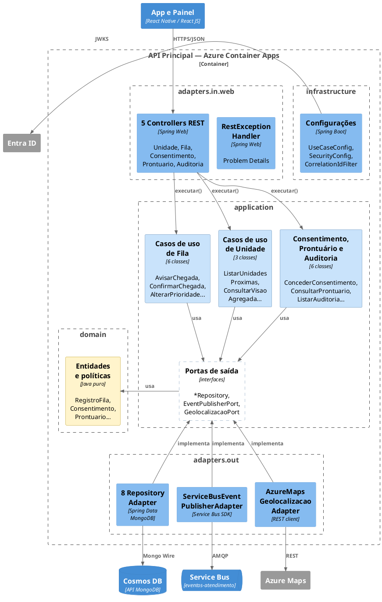

| Camada | Componente | Responsabilidade |
|----------------|-------------------------------------|---------------------------------------------------------------------|
| `adapters.in.web` | `UnidadeController`, `FilaController`, `ConsentimentoController`, `ProntuarioController`, `AuditoriaController` | Recebem HTTP, extraem identidade do JWT (`oid`, `roles`), validam o payload, chamam **um** caso de uso e convertem o resultado em DTO de resposta |
| `adapters.in.web` | `RestExceptionHandler` | Converte exceções de domínio em respostas `application/problem+json` (seção 8.6) |
| `application` | Casos de uso (15 classes `*UseCase`) | Orquestram entidades e portas para cumprir um requisito funcional; cada classe tem um único método público `executar` |
| `application` | Portas de saída | Interfaces `PacienteRepository`, `UnidadeSaudeRepository`, `LotacaoRepository`, `RegistroFilaRepository`, `ProntuarioRepository`, `ConsentimentoRepository`, `LogAuditoriaRepository`, `VisaoAgregadaRepository`, `EventPublisherPort`, `GeolocalizacaoPort` |
| `domain` | Entidades, enumerados, políticas, evento e exceções | Regras de negócio puras (transições de estado, validade do consentimento, ordenação da fila, classificação preliminar) |
| `adapters.out` | `*RepositoryAdapter` | Implementam as portas de persistência com Spring Data MongoDB, convertendo entidades em documentos |
| `adapters.out` | `ServiceBusEventPublisherAdapter` | Implementa `EventPublisherPort` serializando `EventoDominioFila` em JSON |
| `adapters.out` | `AzureMapsGeolocalizacaoAdapter` | Implementa `GeolocalizacaoPort` chamando a Route Matrix API do Azure Maps |
| `infrastructure` | `SecurityConfig`, `UseCaseConfig`, `CorrelationIdFilter`, `ServiceBusConfig`, `MongoConfig`, `TelemetriaConfig` | Configuração de frameworks e composição das dependências |

### Caixa Branca *Worker de Fila*

<!-- fig: c4-n3-worker | C4 Nível 3 — Componentes do Worker de Fila agrupados pelas camadas da Clean Architecture -->
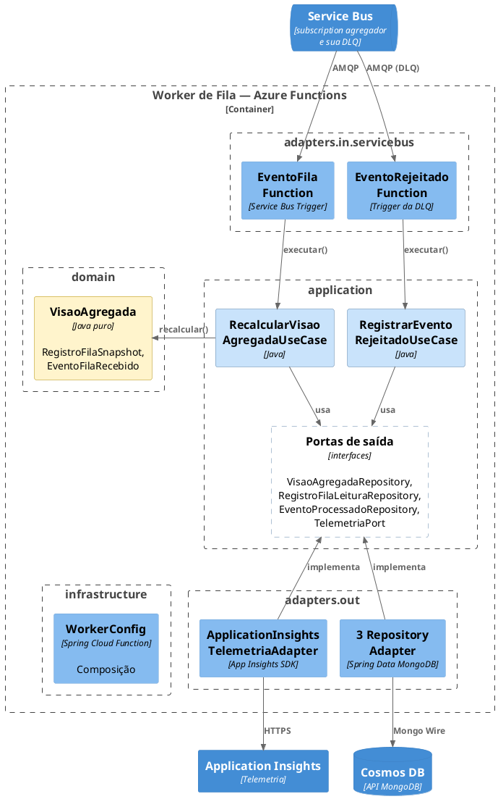

| Camada | Componente | Responsabilidade |
|----------------|-------------------------------------|---------------------------------------------------------------------|
| `adapters.in.servicebus` | `EventoFilaFunction` | Desserializa a mensagem em `EventoFilaRecebido`, propaga o `correlationId` e chama `RecalcularVisaoAgregadaUseCase` |
| `adapters.in.servicebus` | `EventoRejeitadoFunction` | Lê a dead-letter queue da subscription `agregador` e chama `RegistrarEventoRejeitadoUseCase` |
| `application` | `RecalcularVisaoAgregadaUseCase` | Ignora eventos já processados, lê os registros ativos da unidade, recalcula `VisaoAgregada` e marca o evento como processado |
| `application` | `RegistrarEventoRejeitadoUseCase` | Registra a falha como evento customizado de telemetria, que dispara alerta para a equipe |
| `domain` | `VisaoAgregada` | Regra de cálculo de total presente, total a caminho e tempo médio de espera |
| `adapters.out` | `VisaoAgregadaRepositoryAdapter`, `RegistroFilaLeituraRepositoryAdapter`, `EventoProcessadoRepositoryAdapter` | Persistência no Cosmos DB |
| `adapters.out` | `ApplicationInsightsTelemetriaAdapter` | Implementa `TelemetriaPort` com o SDK do Application Insights |
| `infrastructure` | `WorkerConfig` | Instancia casos de uso e adapters para o runtime do Azure Functions |

## 5.3 Nível 3

Esta subseção corresponde ao **C4 Nível 4 — Código**, representado por diagramas UML de **pacotes**, **classes** e **componentes**, seguidos da estrutura do repositório e de trechos do código que materializam a Clean Architecture.

### 5.3.1 Diagrama de Pacotes da Clean Architecture

O diagrama mostra os pacotes da API Principal (o Worker segue a mesma estrutura) e a regra de dependência: todas as setas «use» apontam para dentro, em direção ao domínio; a seta «implementa» indica a inversão de dependência entre adapters de saída e portas.

<!-- fig: pacotes-clean | UML — Diagrama de Pacotes da Clean Architecture e regra de dependência -->
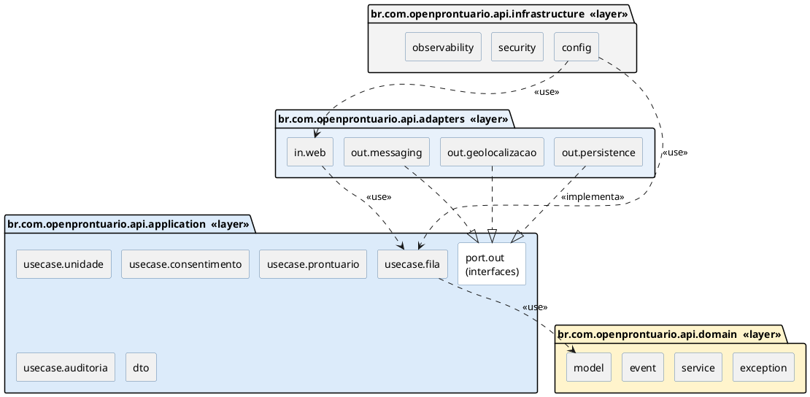

### 5.3.2 Diagrama de Classes — Domínio

<!-- fig: classes-dominio | UML — Diagrama de Classes do pacote domain.model (entidades) -->
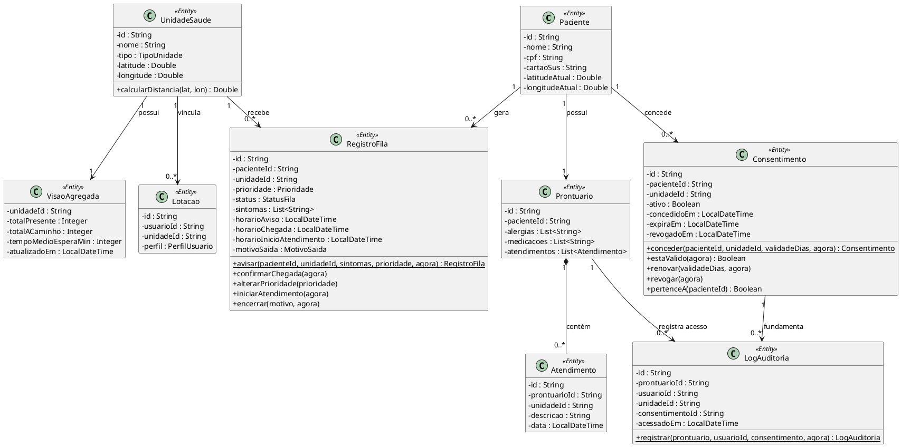

Exceções de domínio (pacote `domain.exception`): `TransicaoInvalidaException`, `ConsentimentoInvalidoException`, `AcessoNegadoException` e `RecursoNaoEncontradoException`, todas subclasses de `DomainException` (extends `RuntimeException`).

Os enumerados, as políticas de domínio e o evento de domínio completam o pacote `domain` (as exceções foram descritas acima):

<!-- fig: classes-dominio-regras | UML — Diagrama de Classes do domínio: enumerados, políticas e evento -->
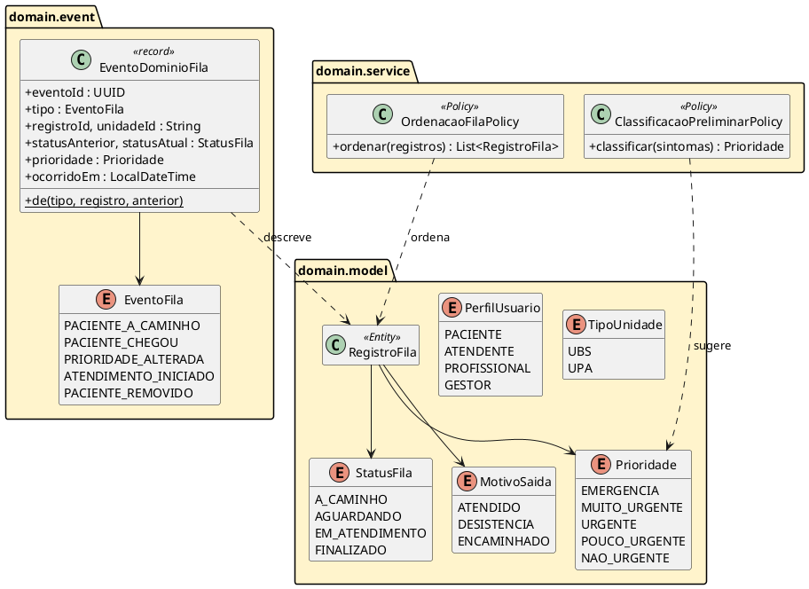

### 5.3.3 Diagrama de Classes — Fila (casos de uso, portas e adaptadores)

Para manter a legibilidade, as dependências entre os casos de uso e as portas estão representadas no nível de pacote: todos os casos de uso de fila dependem de `RegistroFilaRepository`; os que atuam sobre um registro existente verificam a lotação do usuário via `LotacaoRepository`; `AvisarChegadaUseCase` usa `PacienteRepository`; e todos os que mudam estado publicam o evento via `EventPublisherPort`.

<!-- fig: classes-fila | UML — Diagrama de Classes do módulo Fila: controller, casos de uso, portas e adaptadores -->
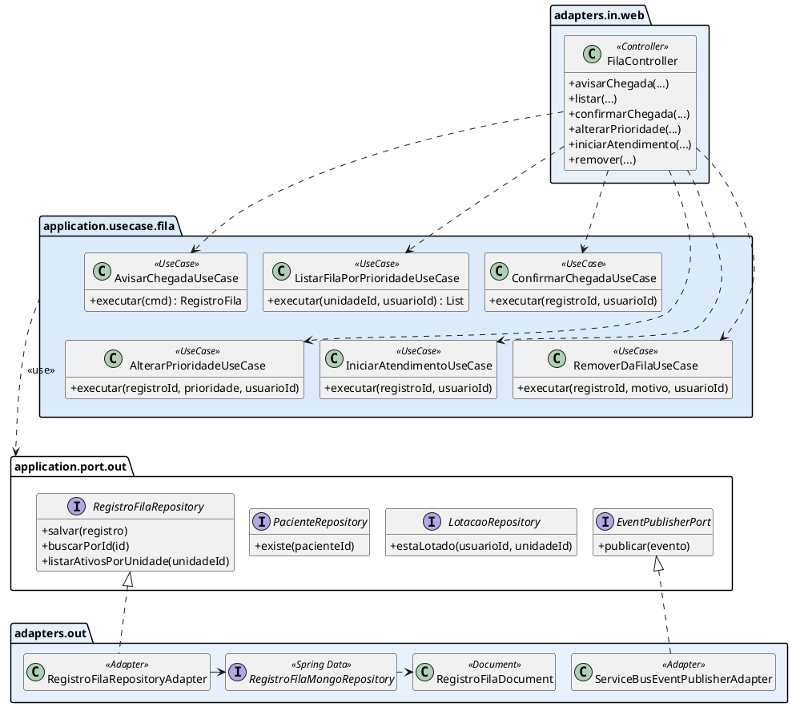

### 5.3.4 Diagrama de Classes — Unidades e Visão Agregada

<!-- fig: classes-unidade | UML — Diagrama de Classes do módulo Unidade: casos de uso, portas e adaptadores -->
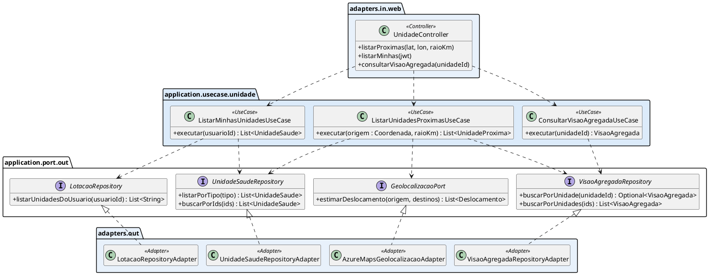

`Coordenada`, `UnidadeProxima` e `Deslocamento` são *records* do pacote `application.dto`. A API apenas **lê** a coleção `visao_agregada`; quem a grava é o Worker de Fila.

### 5.3.5 Diagrama de Classes — Consentimento

<!-- fig: classes-consentimento | UML — Diagrama de Classes do módulo Consentimento (modelo Open Finance) -->
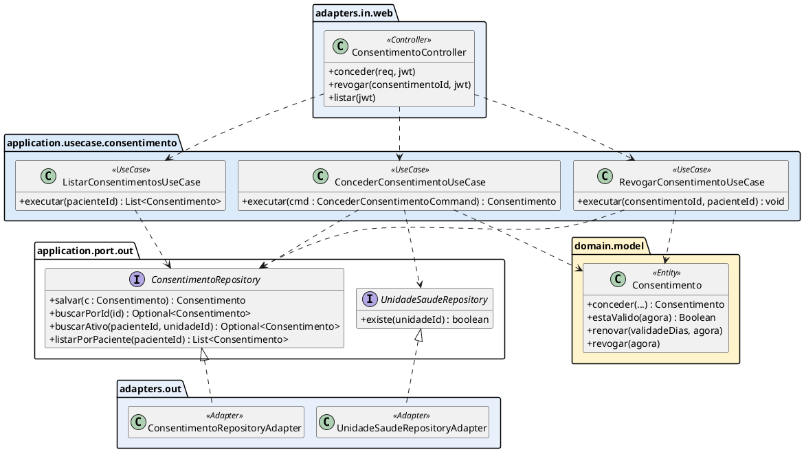

### 5.3.6 Diagrama de Classes — Prontuário e Auditoria

<!-- fig: classes-prontuario | UML — Diagrama de Classes dos módulos Prontuário e Auditoria -->
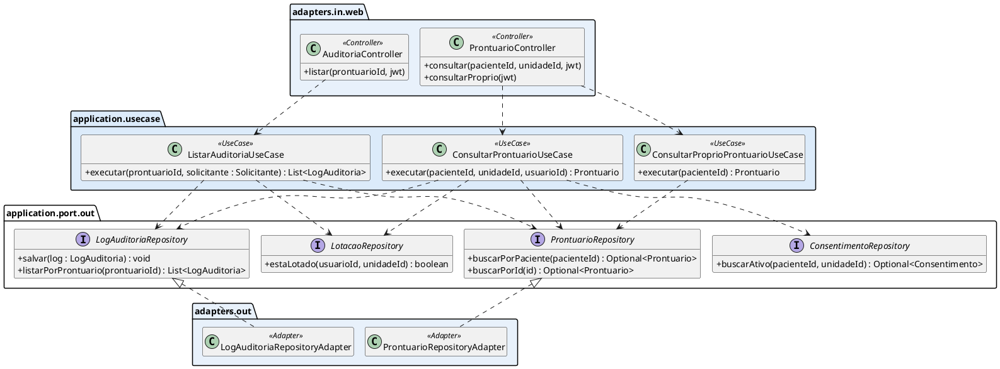

`ConsentimentoRepositoryAdapter` e `LotacaoRepositoryAdapter` já aparecem nas Figuras dos módulos de Consentimento e Unidade. `Solicitante` é um *record* de `application.dto` com o identificador e o perfil do usuário autenticado.

### 5.3.7 Diagrama de Classes — Worker de Fila

<!-- fig: classes-worker | UML — Diagrama de Classes do Worker de Fila (pacote br.com.openprontuario.worker) -->
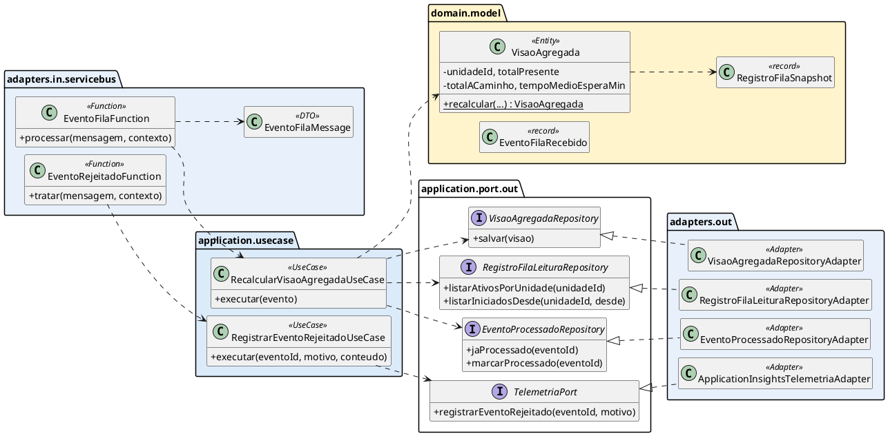

No Worker, as portas ficam em `application.port.out` e os casos de uso em `application.usecase`, com os mesmos nomes de camada da API.

### 5.3.8 Diagrama de Componentes (UML)

O diagrama mostra as **interfaces providas** (linha cheia até o círculo) e **requeridas** (seta tracejada «requer») entre frontends, camadas da API Principal, Worker e serviços externos.

<!-- fig: componentes-uml | UML — Diagrama de Componentes com interfaces providas e requeridas -->
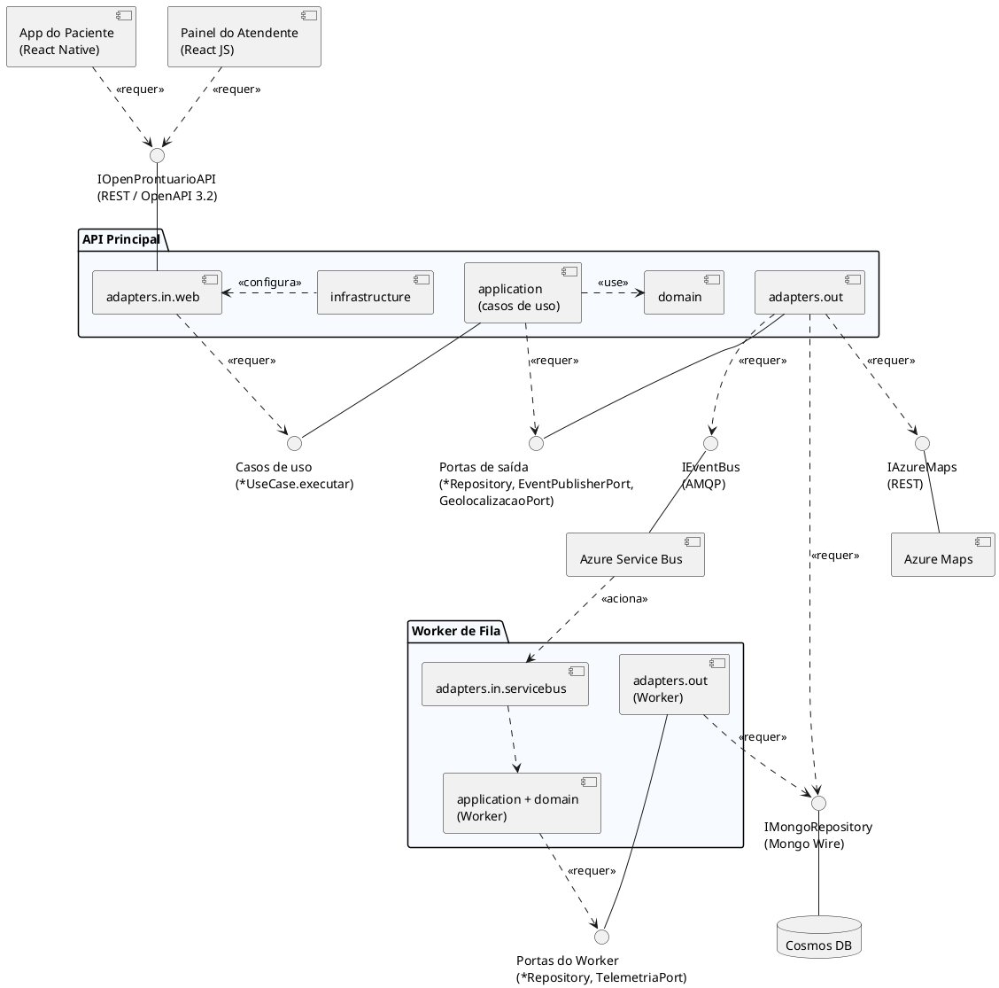

### 5.3.9 Estrutura do repositório (monorepo)

Os nomes de pacotes, classes e arquivos abaixo são os mesmos usados nos diagramas e nos testes ArchUnit da seção 8.8.

```text
open-prontuario/
├── backend/
│   ├── pom.xml                                  (projeto Maven pai)
│   ├── api-principal/
│   │   ├── Dockerfile
│   │   ├── pom.xml
│   │   └── src/
│   │       ├── main/java/br/com/openprontuario/api/
│   │       │   ├── OpenProntuarioApiApplication.java
│   │       │   ├── domain/
│   │       │   │   ├── model/       Paciente, UnidadeSaude, Lotacao, RegistroFila,
│   │       │   │   │                Prontuario, Atendimento, Consentimento, LogAuditoria,
│   │       │   │   │                VisaoAgregada, Prioridade, StatusFila, MotivoSaida,
│   │       │   │   │                TipoUnidade, PerfilUsuario
│   │       │   │   ├── service/     OrdenacaoFilaPolicy, ClassificacaoPreliminarPolicy
│   │       │   │   ├── event/       EventoFila, EventoDominioFila
│   │       │   │   └── exception/   DomainException, TransicaoInvalidaException,
│   │       │   │                    ConsentimentoInvalidoException, AcessoNegadoException,
│   │       │   │                    RecursoNaoEncontradoException
│   │       │   ├── application/
│   │       │   │   ├── usecase/
│   │       │   │   │   ├── fila/           AvisarChegadaUseCase,
│   │       │   │   │   │                   ListarFilaPorPrioridadeUseCase,
│   │       │   │   │   │                   ConfirmarChegadaUseCase, AlterarPrioridadeUseCase,
│   │       │   │   │   │                   IniciarAtendimentoUseCase, RemoverDaFilaUseCase
│   │       │   │   │   ├── unidade/        ListarUnidadesProximasUseCase,
│   │       │   │   │   │                   ListarMinhasUnidadesUseCase,
│   │       │   │   │   │                   ConsultarVisaoAgregadaUseCase
│   │       │   │   │   ├── consentimento/  ConcederConsentimentoUseCase,
│   │       │   │   │   │                   RevogarConsentimentoUseCase,
│   │       │   │   │   │                   ListarConsentimentosUseCase
│   │       │   │   │   ├── prontuario/     ConsultarProntuarioUseCase,
│   │       │   │   │   │                   ConsultarProprioProntuarioUseCase
│   │       │   │   │   └── auditoria/      ListarAuditoriaUseCase
│   │       │   │   ├── dto/         AvisarChegadaCommand, ConcederConsentimentoCommand,
│   │       │   │   │                Coordenada, Deslocamento, UnidadeProxima, Solicitante
│   │       │   │   └── port/out/    PacienteRepository, UnidadeSaudeRepository,
│   │       │   │                    LotacaoRepository,
│   │       │   │                    RegistroFilaRepository, ProntuarioRepository,
│   │       │   │                    ConsentimentoRepository, LogAuditoriaRepository,
│   │       │   │                    VisaoAgregadaRepository, EventPublisherPort,
│   │       │   │                    GeolocalizacaoPort
│   │       │   ├── adapters/
│   │       │   │   ├── in/web/      UnidadeController, FilaController, ConsentimentoController,
│   │       │   │   │                ProntuarioController, AuditoriaController,
│   │       │   │   │                RestExceptionHandler, dto/ (requests e responses)
│   │       │   │   └── out/
│   │       │   │       ├── persistence/     PacienteRepositoryAdapter,
│   │       │   │       │                    UnidadeSaudeRepositoryAdapter,
│   │       │   │       │                    LotacaoRepositoryAdapter,
│   │       │   │       │                    RegistroFilaRepositoryAdapter,
│   │       │   │       │                    ProntuarioRepositoryAdapter,
│   │       │   │       │                    ConsentimentoRepositoryAdapter,
│   │       │   │       │                    LogAuditoriaRepositoryAdapter,
│   │       │   │       │                    VisaoAgregadaRepositoryAdapter,
│   │       │   │       │                    RegistroFilaMongoRepository,
│   │       │   │       │                    demais *MongoRepository,
│   │       │   │       │                    *Document
│   │       │   │       ├── messaging/       ServiceBusEventPublisherAdapter,
│   │       │   │       │                    EventoFilaMessage
│   │       │   │       └── geolocalizacao/  AzureMapsGeolocalizacaoAdapter
│   │       │   └── infrastructure/
│   │       │       ├── config/          UseCaseConfig, MongoConfig,
│   │       │       │                    ServiceBusConfig, AzureMapsConfig
│   │       │       ├── security/        SecurityConfig
│   │       │       └── observability/   CorrelationIdFilter, TelemetriaConfig
│   │       ├── main/resources/application.yml
│   │       └── test/java/br/com/openprontuario/api/
│   │           ├── architecture/    ArquiteturaApiTest            (ArchUnit)
│   │           ├── domain/          RegistroFilaTest, ConsentimentoTest,
│   │           │                    OrdenacaoFilaPolicyTest
│   │           ├── application/     ConfirmarChegadaUseCaseTest,
│   │           │                    ConsultarProntuarioUseCaseTest, ...
│   │           └── adapters/        FilaControllerTest (MockMvc),
│   │                                RegistroFilaRepositoryAdapterIT
│   └── worker-fila/
│       ├── host.json
│       ├── pom.xml
│       └── src/
│           ├── main/java/br/com/openprontuario/worker/
│           │   ├── domain/model/        VisaoAgregada, RegistroFilaSnapshot,
│           │   │                        EventoFilaRecebido,
│           │   │                        StatusFila, EventoFila
│           │   ├── domain/exception/    EventoInvalidoException
│           │   ├── application/usecase/ RecalcularVisaoAgregadaUseCase,
│           │   │                        RegistrarEventoRejeitadoUseCase
│           │   ├── application/port/out/ VisaoAgregadaRepository,
│           │   │                        RegistroFilaLeituraRepository,
│           │   │                        EventoProcessadoRepository, TelemetriaPort
│           │   ├── adapters/in/servicebus/ EventoFilaFunction,
│           │   │                        EventoRejeitadoFunction, EventoFilaMessage
│           │   ├── adapters/out/persistence/ VisaoAgregadaRepositoryAdapter,
│           │   │                        RegistroFilaLeituraRepositoryAdapter,
│           │   │                        EventoProcessadoRepositoryAdapter
│           │   ├── adapters/out/telemetria/  ApplicationInsightsTelemetriaAdapter
│           │   └── infrastructure/config/    WorkerConfig
│           └── test/java/br/com/openprontuario/worker/
│               ├── architecture/    ArquiteturaWorkerTest         (ArchUnit)
│               └── domain/          VisaoAgregadaTest
├── frontend/
│   ├── painel-atendente/            React JS (Vite)
│   │   └── src/
│   │       ├── pages/       TelaSelecaoUnidade, TelaFila, TelaProntuario,
│   │       │                TelaAuditoria, TelaIndicadores
│   │       ├── services/    apiClient.js (fetch + token MSAL), filaService.js
│   │       ├── hooks/       useFila.js (atualização periódica da fila)
│   │       └── auth/        msalConfig.js
│   └── app-paciente/                React Native (Expo)
│       └── src/
│           ├── screens/     TelaMapa, TelaAvisoChegada, TelaConsentimento, TelaMeuProntuario
│           ├── services/    apiClient.js, localizacao.js
│           └── auth/        msalConfig.js
├── infra/
│   └── bicep/   main.bicep, modules/ (staticwebapp, containerapp, functions,
│                servicebus, cosmos, appinsights)
├── docs/
│   ├── arc42_open_prontuario.md
│   ├── openapi_prontuario_filas.yaml
│   └── diagramas/   *.puml e *.png
└── .github/workflows/   ci.yml (build + testes + ArchUnit), deploy.yml
```

### 5.3.10 Trechos de código que materializam a Clean Architecture

**Entidade de domínio** — as transições da máquina de estados ficam na própria entidade, sem dependência de framework:

```java
package br.com.openprontuario.api.domain.model;

public class RegistroFila {
    // atributos privados: id, pacienteId, unidadeId, prioridade, status, sintomas,
    // horarioAviso, horarioChegada, horarioInicioAtendimento, motivoSaida

    public static RegistroFila avisar(String pacienteId, String unidadeId, List<String> sintomas,
                                      Prioridade prioridadePreliminar, LocalDateTime agora) {
        return new RegistroFila(UUID.randomUUID().toString(), pacienteId, unidadeId,
                prioridadePreliminar, StatusFila.A_CAMINHO, List.copyOf(sintomas), agora);
    }

    public void confirmarChegada(LocalDateTime agora) {
        exigirStatus(StatusFila.A_CAMINHO, StatusFila.AGUARDANDO);
        this.status = StatusFila.AGUARDANDO;
        this.horarioChegada = agora;
    }

    public void alterarPrioridade(Prioridade nova) {
        if (status == StatusFila.EM_ATENDIMENTO || status == StatusFila.FINALIZADO) {
            throw new TransicaoInvalidaException("Prioridade só pode mudar antes do atendimento");
        }
        this.prioridade = Objects.requireNonNull(nova);
    }

    public void iniciarAtendimento(LocalDateTime agora) {
        exigirStatus(StatusFila.AGUARDANDO, StatusFila.EM_ATENDIMENTO);
        this.status = StatusFila.EM_ATENDIMENTO;
        this.horarioInicioAtendimento = agora;
    }

    public void encerrar(MotivoSaida motivo, LocalDateTime agora) {
        boolean permitido = switch (status) {
            case A_CAMINHO -> motivo == MotivoSaida.DESISTENCIA;
            case AGUARDANDO -> motivo != MotivoSaida.ATENDIDO;
            case EM_ATENDIMENTO -> motivo == MotivoSaida.ATENDIDO;
            case FINALIZADO -> false;
        };
        if (!permitido) {
            throw new TransicaoInvalidaException(status + " -> FINALIZADO (" + motivo + ")");
        }
        this.status = StatusFila.FINALIZADO;
        this.motivoSaida = motivo;
    }

    private void exigirStatus(StatusFila esperado, StatusFila destino) {
        if (status != esperado) {
            throw new TransicaoInvalidaException(status + " -> " + destino);
        }
    }
}
```

**Porta de saída** (camada `application`) — interface que o caso de uso conhece:

```java
package br.com.openprontuario.api.application.port.out;

public interface EventPublisherPort {
    void publicar(EventoDominioFila evento);
}
```

**Caso de uso** (camada `application`) — Java puro, sem anotações do Spring:

```java
package br.com.openprontuario.api.application.usecase.fila;

public class ConfirmarChegadaUseCase {
    private final RegistroFilaRepository registros;
    private final LotacaoRepository lotacoes;
    private final EventPublisherPort eventos;
    private final Clock relogio;

    public ConfirmarChegadaUseCase(RegistroFilaRepository registros, LotacaoRepository lotacoes,
                                   EventPublisherPort eventos, Clock relogio) {
        this.registros = registros;
        this.lotacoes = lotacoes;
        this.eventos = eventos;
        this.relogio = relogio;
    }

    public RegistroFila executar(String registroId, String usuarioId) {
        RegistroFila registro = registros.buscarPorId(registroId)
                .orElseThrow(() -> new RecursoNaoEncontradoException("RegistroFila", registroId));
        if (!lotacoes.estaLotado(usuarioId, registro.getUnidadeId())) {
            throw new AcessoNegadoException("Usuário não está lotado na unidade do registro");
        }
        StatusFila anterior = registro.getStatus();
        registro.confirmarChegada(LocalDateTime.now(relogio));
        RegistroFila salvo = registros.salvar(registro);
        eventos.publicar(EventoDominioFila.de(EventoFila.PACIENTE_CHEGOU, salvo, anterior));
        return salvo;
    }
}
```

**Adapter de saída** (camada `adapters`) — implementa a porta com o SDK do Service Bus:

```java
package br.com.openprontuario.api.adapters.out.messaging;

@Component
public class ServiceBusEventPublisherAdapter implements EventPublisherPort {
    private final ServiceBusSenderClient sender;
    private final ObjectMapper json;

    public ServiceBusEventPublisherAdapter(ServiceBusSenderClient sender, ObjectMapper json) {
        this.sender = sender;
        this.json = json;
    }

    @Override
    public void publicar(EventoDominioFila evento) {
        try {
            ServiceBusMessage msg = new ServiceBusMessage(json.writeValueAsBytes(EventoFilaMessage.de(evento)));
            msg.setMessageId(evento.eventoId().toString());   // detecção de duplicatas
            msg.setSubject(evento.tipo().name());
            msg.setContentType("application/json");
            msg.setCorrelationId(MDC.get("correlationId"));
            msg.getApplicationProperties().put("unidadeId", evento.unidadeId());
            sender.sendMessage(msg);
        } catch (JsonProcessingException e) {
            throw new IllegalStateException("Falha ao serializar evento " + evento.eventoId(), e);
        }
    }
}
```

**Adapter de entrada** (camada `adapters`) — o controller apenas traduz HTTP para a chamada do caso de uso:

```java
package br.com.openprontuario.api.adapters.in.web;

@RestController
@RequestMapping("/fila")
public class FilaController {
    private final ConfirmarChegadaUseCase confirmarChegada;
    // ... demais casos de uso de fila injetados pelo construtor

    @PostMapping("/{registroId}/confirmar-chegada")
    @PreAuthorize("hasAnyRole('ATENDENTE', 'PROFISSIONAL')")
    public RegistroFilaResponse confirmarChegada(@PathVariable String registroId,
                                                 @AuthenticationPrincipal Jwt jwt) {
        return RegistroFilaResponse.de(confirmarChegada.executar(registroId, jwt.getClaimAsString("oid")));
    }
}
```

**Composição** (camada `infrastructure`) — único ponto que conhece todas as camadas:

```java
package br.com.openprontuario.api.infrastructure.config;

@Configuration
public class UseCaseConfig {
    @Bean
    Clock relogio() {
        return Clock.system(ZoneId.of("America/Sao_Paulo"));
    }

    @Bean
    ConfirmarChegadaUseCase confirmarChegadaUseCase(RegistroFilaRepository registros,
            LotacaoRepository lotacoes, EventPublisherPort eventos, Clock relogio) {
        return new ConfirmarChegadaUseCase(registros, lotacoes, eventos, relogio);
    }
    // ... um @Bean por caso de uso (15 na API)
}
```

\newpage

# 6. Visão de Tempo de Execução

Os diagramas desta seção correspondem ao **C4 Nível 4 — UML, Diagramas de Sequência e de Estados**. Todos mostram a passagem pelas camadas da Clean Architecture: **Controller → UseCase → Porta → Adapter**. Quando a porta e o adapter aparecem no mesmo participante, o nome da porta vem na primeira linha e o adapter que a implementa na segunda.

## 6.1 Paciente consulta as UPAs próximas (RF02)

<!-- fig: seq-a1-unidades-proximas | UML Sequência — Paciente consulta as UPAs próximas -->
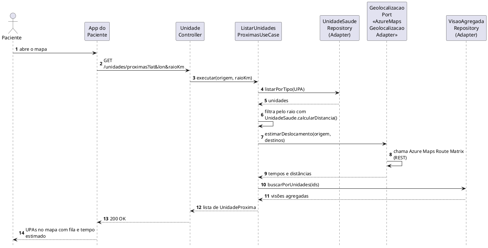

## 6.2 Paciente avisa a chegada com sintomas (RF03, RF04, RF17)

<!-- fig: seq-a2-aviso-chegada | UML Sequência — Paciente avisa a chegada e o evento PacienteACaminho é publicado -->
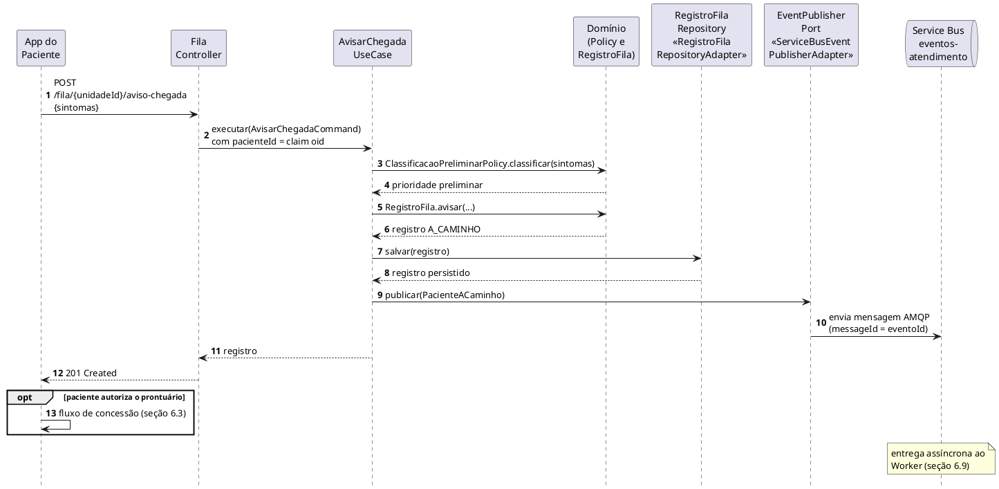

## 6.3 Concessão de consentimento — modelo Open Finance (RF05)

<!-- fig: seq-b1-concessao | UML Sequência — Concessão (ou renovação) do consentimento de compartilhamento do prontuário -->
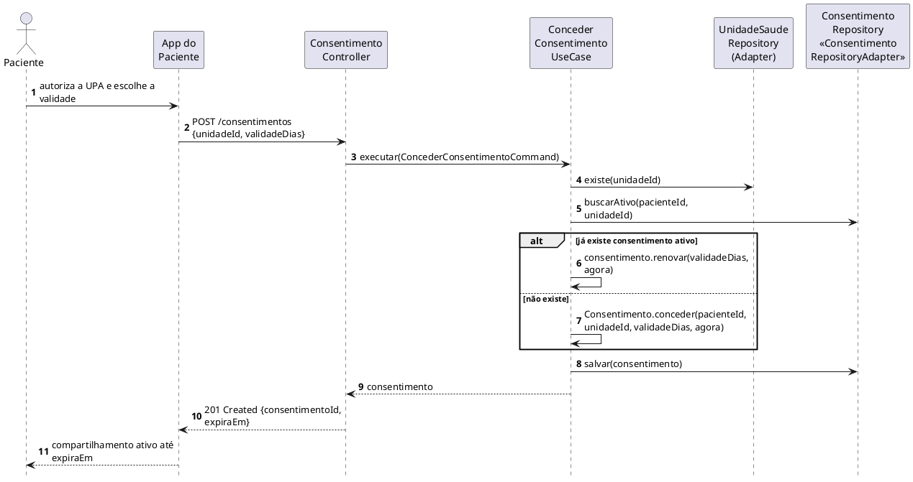

## 6.4 Revogação de consentimento (RF05, RF06)

<!-- fig: seq-b2-revogacao | UML Sequência — Revogação do consentimento pelo paciente -->
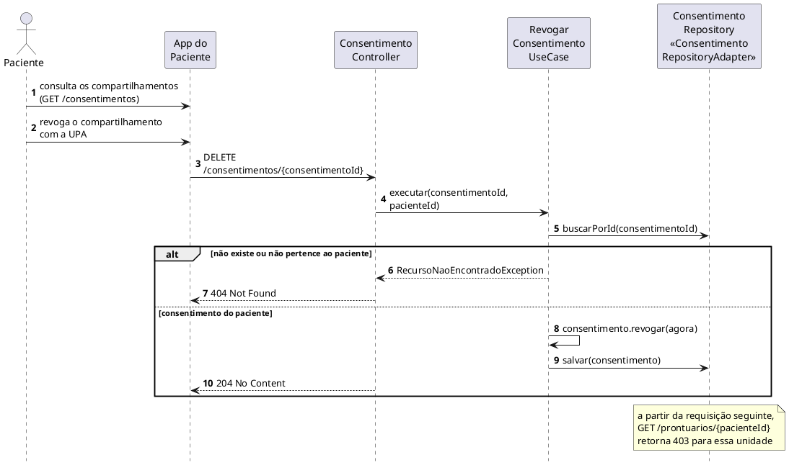

## 6.5 Atendente consulta o prontuário com validação de consentimento e auditoria (RF12, RF15)

<!-- fig: seq-c-prontuario | UML Sequência — Consulta ao prontuário com validação de lotação, consentimento e registro de auditoria -->
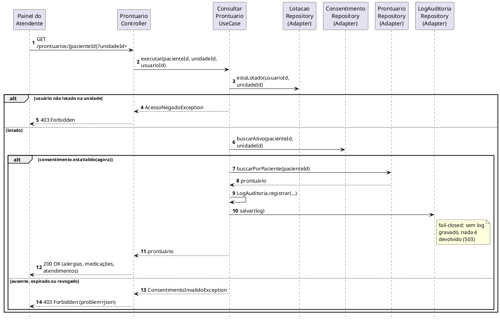

## 6.6 Atendente visualiza a fila e confirma a chegada (RF07 a RF10)

<!-- fig: seq-d1-fila-chegada | UML Sequência — Fila priorizada e confirmação da chegada física -->
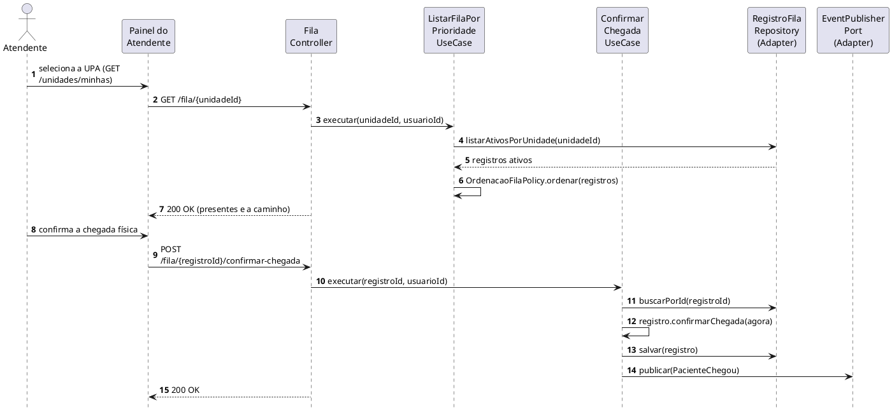

## 6.7 Atendente altera a prioridade após a triagem (RF11)

<!-- fig: seq-d2-prioridade | UML Sequência — Repriorização do paciente após a triagem -->
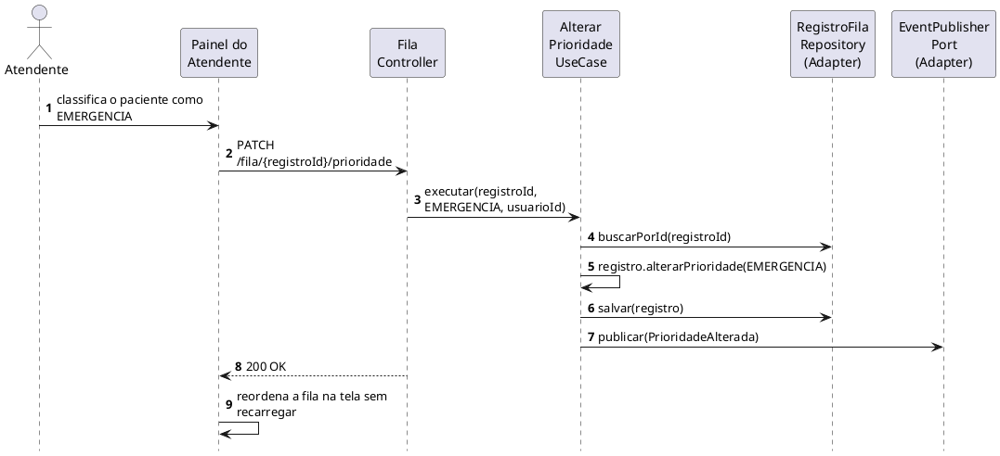

## 6.8 Atendente inicia e encerra o atendimento (RF13, RF14)

<!-- fig: seq-d3-iniciar-encerrar | UML Sequência — Início e encerramento do atendimento, com tratamento de transição inválida -->
```plantuml
@startuml
hide footbox
autonumber
skinparam maxMessageSize 200
skinparam ParticipantPadding 6

actor "Atendente /\nProfissional" as A
participant "Painel do\nAtendente" as W
participant "Fila\nController" as C
participant "Iniciar\nAtendimento\nUseCase" as IA
participant "RemoverDaFila\nUseCase" as RD
participant "RegistroFila\n(domínio)" as D
participant "RegistroFila\nRepository\n(Adapter)" as R
participant "EventPublisher\nPort\n(Adapter)" as E

A -> W : inicia o atendimento
W -> C : POST /fila/{registroId}/iniciar-atendimento
C -> IA : executar(registroId, usuarioId)
IA -> R : buscarPorId(registroId)
IA -> D : iniciarAtendimento(agora)
alt status diferente de AGUARDANDO
  D --> IA : TransicaoInvalidaException
  C --> W : 409 Conflict
else AGUARDANDO
  D --> IA : status EM_ATENDIMENTO
  IA -> R : salvar(registro)
  IA -> E : publicar(AtendimentoIniciado)
  C --> W : 200 OK
end

A -> W : encerra o registro (motivo ATENDIDO)
W -> C : DELETE /fila/{registroId}?motivo=ATENDIDO
C -> RD : executar(registroId, ATENDIDO, usuarioId)
RD -> R : buscarPorId(registroId)
RD -> D : encerrar(ATENDIDO, agora)
D --> RD : status FINALIZADO
RD -> R : salvar(registro)
RD -> E : publicar(PacienteRemovido)
C --> W : 204 No Content
@enduml
```

## 6.9 Worker processa um evento e recalcula a visão agregada, com reprocessamento (RF17, RF18)

<!-- fig: seq-e1-worker-reprocessamento | UML Sequência — Processamento idempotente no Worker e reentrega em caso de falha -->
```plantuml
@startuml
hide footbox
autonumber
skinparam maxMessageSize 200
skinparam ParticipantPadding 6

queue "Service Bus\nsubscription agregador" as B
participant "EventoFila\nFunction" as F
participant "RecalcularVisao\nAgregadaUseCase" as UC
participant "EventoProcessadoRepository\n(Adapter)" as EP
participant "RegistroFilaLeituraRepository\n(Adapter)" as RL
participant "VisaoAgregadaRepository\n(Adapter)" as VR

B -> F : entrega mensagem (peek-lock, tentativa n)
F -> F : desserializa EventoFilaMessage\ne propaga correlationId
F -> UC : executar(EventoFilaRecebido)
UC -> EP : jaProcessado(eventoId)
alt evento já processado (duplicata)
  UC --> F : retorna sem efeito
  F --> B : complete
else evento novo
  UC -> RL : listarAtivosPorUnidade(unidadeId)
  UC -> RL : listarIniciadosDesde(unidadeId, agora - 2h)
  UC -> UC : VisaoAgregada.recalcular(...)
  UC -> VR : salvar(visao)
  alt gravação concluída
    UC -> EP : marcarProcessado(eventoId)
    F --> B : complete
  else falha transitória (ex.: Cosmos DB 429 ou timeout)
    VR --> UC : exceção
    UC --> F : exceção propagada
    F --> B : abandon (mensagem volta à subscription)
    B -> F : reentrega (tentativa n + 1, até 5)
  end
end
@enduml
```

## 6.10 Evento rejeitado é encaminhado à dead-letter queue (RF17)

<!-- fig: seq-e2-dead-letter | UML Sequência — Encaminhamento à dead-letter queue, alerta e reprocessamento manual -->
```plantuml
@startuml
hide footbox
autonumber
skinparam maxMessageSize 200
skinparam ParticipantPadding 6

queue "Service Bus\nsubscription agregador" as B
queue "Dead-letter\nqueue" as DLQ
participant "EventoRejeitado\nFunction" as F
participant "Registrar\nEventoRejeitado\nUseCase" as UC
participant "TelemetriaPort\n«ApplicationInsights\nTelemetriaAdapter»" as T
participant "Application\nInsights" as AI
actor "Equipe de\noperação" as O

B -> B : 5ª falha de entrega (maxDeliveryCount = 5)
B -> DLQ : move a mensagem\n(DeadLetterReason = MaxDeliveryCountExceeded)
DLQ -> F : entrega a mensagem rejeitada
F -> UC : executar(eventoId, motivo, conteúdo)
UC -> T : registrarEventoRejeitado(eventoId, motivo)
T -> AI : trackEvent("EventoRejeitado")
AI -> O : alerta (regra de alerta sobre o evento)
O -> O : corrige a causa (ex.: aumenta RU/s)
O -> B : reenvia a mensagem da DLQ\n(Service Bus Explorer)
note over B : o reprocessamento é seguro:\no recálculo é idempotente e\no eventoId é verificado
@enduml
```

## 6.11 Ciclo de vida do registro na fila (máquina de estados)

O diagrama consolida as transições exercidas pelos cenários 6.2 e 6.6 a 6.8, garantindo que todo valor do enumerado `StatusFila` seja alcançável e que cada transição tenha um endpoint, um método de domínio e um evento correspondentes.

<!-- fig: estados-registro-fila | UML Estados — Ciclo de vida do RegistroFila -->
```plantuml
@startuml
hide empty description
skinparam ranksep 45

[*] --> A_CAMINHO : POST /fila/{unidadeId}/aviso-chegada\nRegistroFila.avisar()\nevento PacienteACaminho
A_CAMINHO --> AGUARDANDO : POST .../confirmar-chegada\nconfirmarChegada()\nevento PacienteChegou
AGUARDANDO --> EM_ATENDIMENTO : POST .../iniciar-atendimento\niniciarAtendimento()\nevento AtendimentoIniciado
EM_ATENDIMENTO --> FINALIZADO : DELETE /fila/{registroId}?motivo=ATENDIDO\nencerrar()\nevento PacienteRemovido
A_CAMINHO --> FINALIZADO : DELETE ?motivo=DESISTENCIA
AGUARDANDO --> FINALIZADO : DELETE ?motivo=DESISTENCIA\nou ENCAMINHADO
A_CAMINHO --> A_CAMINHO : PATCH .../prioridade\nevento PrioridadeAlterada
AGUARDANDO --> AGUARDANDO : PATCH .../prioridade\nevento PrioridadeAlterada
FINALIZADO --> [*]
@enduml
```

Qualquer outra transição solicitada lança `TransicaoInvalidaException`, convertida em `409 Conflict` pelo `RestExceptionHandler`.

\newpage

# 7. Visão de Implantação

## 7.1 Nível de Infraestrutura 1

***Diagrama de Visão Geral***

<!-- fig: implantacao | UML Implantação — Infraestrutura Azure do Open Prontuário -->
```plantuml
@startuml
skinparam nodesep 20
skinparam ranksep 40
skinparam defaultTextAlignment center

node "Smartphone do Paciente\n<<device>>" as cel {
  artifact "app-paciente\n(React Native)" as aApp
}
node "Estação da Recepção\n<<device>>" as desk {
  node "Navegador web" as nav
}
node "GitHub" as gh {
  artifact "Actions\n(CI/CD + ArchUnit)" as ci
  artifact "Container\nRegistry" as ghcr
}

rectangle "Resource Group rg-openprontuario — Azure" as rg {
  node "Static Web Apps\n(Free)" as swa {
    artifact "painel-atendente\n(build React)" as aWeb
  }
  node "Container Apps\n(Consumption)" as aca {
    artifact "api-principal\n(imagem Docker)" as aApi
  }
  node "Service Bus\n(Standard)" as sbn {
    artifact "tópico eventos-atendimento\n+ subscription + DLQ" as aTop
  }
  node "Functions\n(Consumption)" as fun {
    artifact "worker-fila.jar" as aWorker
  }
  database "Cosmos DB API MongoDB\n(Free Tier)" as cdb {
    artifact "openprontuario\n(10 coleções)" as aDb
  }
  node "Application\nInsights" as ins
}

rectangle "SaaS" as ext {
  node "Microsoft\nEntra ID" as entra
  node "Azure Maps\n(Gen2)" as maps
}

aApp --> aApi : HTTPS
nav --> aWeb : HTTPS
nav --> aApi : HTTPS
ci -right-> ghcr : publica
ghcr ..> aApi : pull
aApi --> aTop : AMQP
aTop --> aWorker : AMQP
aApi --> aDb : Mongo Wire
aWorker -left-> aDb : Mongo Wire
aApi -right-> entra : OIDC
aApi -right-> maps : REST
aWorker .right.> ins : telemetria
aApi ..> ins : telemetria
@enduml
```

Motivação
:   Concentrar os recursos em um único grupo de recursos simplifica o provisionamento via Bicep, o controle de custos e a remoção do ambiente ao final do ciclo acadêmico.

Características de Qualidade e/ou Desempenho
:   Container Apps e Functions escalam automaticamente conforme a demanda; o Service Bus absorve picos de eventos sem sobrecarregar o banco; o app móvel comunica-se diretamente com a API, sem depender do Static Web Apps; o pipeline de CI executa os testes unitários e de arquitetura antes de qualquer implantação.

Mapeamento de Blocos de Construção para Infraestrutura
:   Ver tabela abaixo.

| Bloco de construção (C4 Nível 2) | Infraestrutura Azure | Tier / plano | Artefato implantado |
|---------------------------|----------------------------|------------------------------|----------------------------------|
| App do Paciente | Dispositivo móvel do usuário | — (lojas de aplicativos / Expo) | `app-paciente` |
| Painel do Atendente | Azure Static Web Apps | Free | build estático React (`painel-atendente`) |
| API Principal | Azure Container Apps | Consumption; réplica mínima 1 das 7h às 22h, escala a zero fora do expediente | imagem Docker `api-principal` |
| Fila de Eventos | Azure Service Bus | Standard (necessário para tópicos e subscriptions) | tópico `eventos-atendimento` |
| Worker de Fila | Azure Functions | Consumption | `worker-fila.jar` |
| Banco de Dados | Azure Cosmos DB (API MongoDB) | Free Tier (1000 RU/s compartilhados, 25 GB) | database `openprontuario` |
| Observabilidade | Application Insights + Log Analytics | Pago por ingestão, com limite diário configurado | — |
| (externo) Microsoft Entra ID | SaaS | Free | registros de aplicativo e *app roles* |
| (externo) Azure Maps | SaaS | Gen2, cota gratuita mensal | — |

## 7.2 Nível de Infraestrutura 2

### Azure Static Web Apps

Hospeda o build estático do Painel do Atendente (React JS), com CDN integrada, HTTPS gerenciado e deploy pelo GitHub Actions a cada *merge* na branch principal. Tier gratuito.

### Azure Container Apps

Executa a imagem de contêiner da API Spring Boot (0,5 vCPU / 1 GiB), com escala automática por número de requisições HTTP concorrentes (regra HTTP de 50 requisições por réplica, máximo de 3 réplicas). Uma regra de escala agendada mantém uma réplica mínima durante o horário de funcionamento das unidades, eliminando o *cold start* (seção 11), e permite escala a zero fora dele. Segredos (cadeias de conexão do Cosmos DB e do Service Bus, chave do Azure Maps) são armazenados como *secrets* do Container App. A imagem é obtida do GitHub Container Registry.

### Azure Functions

Executa o Worker de Fila em plano Consumption (Java 21), acionado por dois gatilhos do Service Bus: a subscription `agregador` (`EventoFilaFunction`) e a sua dead-letter queue (`EventoRejeitadoFunction`). Cobrança apenas por execução.

### Azure Service Bus

Namespace único, tier Standard (necessário para tópicos e subscriptions):

| Recurso | Configuração |
|------------------------------|--------------------------------------------------------------------------|
| Tópico `eventos-atendimento` | Detecção de duplicatas habilitada (janela de 10 minutos, usando `messageId = eventoId`); TTL padrão de 1 dia |
| Subscription `agregador` | `maxDeliveryCount = 5`; `lockDuration = 60 s`; dead-lettering em expiração habilitado |
| Dead-letter queue | `eventos-atendimento/Subscriptions/agregador/$DeadLetterQueue`, consumida por `EventoRejeitadoFunction` |

### Azure Cosmos DB

Conta única com API MongoDB, em Free Tier, com a database `openprontuario` usando *throughput* compartilhado de 1000 RU/s entre as dez coleções descritas na seção 8.1.

### Application Insights

Recebe a telemetria da API (agente Java do Application Insights) e do Worker, permitindo rastrear latência das requisições, dependências (Cosmos DB, Service Bus, Azure Maps), falhas de processamento e mensagens encaminhadas à dead-letter queue. Um limite diário de ingestão evita surpresas de custo.

### Pipeline de CI/CD (GitHub Actions)

`ci.yml` compila os módulos Maven, executa os testes unitários, os testes ArchUnit e os testes dos frontends; uma falha em qualquer regra de arquitetura bloqueia o *merge*. `deploy.yml` publica a imagem da API no GitHub Container Registry, implanta a nova revisão do Container App, o pacote do Worker e o build do Painel, e aplica os templates Bicep da pasta `infra/bicep`.

\newpage

# 8. Conceitos Transversais

## 8.1 Modelo de Dados

O diagrama a seguir apresenta o **Diagrama de Entidades e Relacionamentos (DER)**. Como a persistência é orientada a documentos (Cosmos DB, API MongoDB), as "chaves estrangeiras" são referências por identificador mantidas pela aplicação (não há integridade referencial no banco), e os campos `sintomas`, `alergias` e `medicacoes` são materializados como arrays de strings no documento, conforme o diagrama de classes (seção 5.3) e a especificação OpenAPI. Em relação à versão anterior do modelo, foram acrescentadas as entidades `LOTACAO` (vínculo do profissional com a unidade, usado em `GET /unidades/minhas` e nas verificações de acesso) e `EVENTO_PROCESSADO` (idempotência do Worker), além dos campos `expiraEm` em `CONSENTIMENTO` e `consentimentoId` em `LOG_AUDITORIA`.

<!-- fig: der | DER — Diagrama de Entidades e Relacionamentos do Open Prontuário -->
```plantuml
@startuml
hide circle
skinparam linetype ortho
skinparam nodesep 35
skinparam ranksep 45

entity "PACIENTE" as paciente {
  * id : string <<PK>> (oid do Entra ID)
  --
  nome : string
  cpf : string
  cartaoSus : string
  latitudeAtual : float
  longitudeAtual : float
}
entity "UNIDADE_SAUDE" as unidade {
  * id : string <<PK>>
  --
  nome : string
  tipo : string (UBS, UPA)
  latitude : float
  longitude : float
}
entity "LOTACAO" as lotacao {
  * id : string <<PK>>
  --
  usuarioId : string (oid)
  unidadeId : string <<FK>>
  perfil : string
}
entity "REGISTRO_FILA" as registro {
  * id : string <<PK>>
  --
  pacienteId : string <<FK>>
  unidadeId : string <<FK>>
  prioridade : string
  status : string
  sintomas : string[]
  horarioAviso : datetime
  horarioChegada : datetime
  horarioInicioAtendimento : datetime
  motivoSaida : string
}
entity "PRONTUARIO" as prontuario {
  * id : string <<PK>>
  --
  pacienteId : string <<FK>>
  alergias : string[]
  medicacoes : string[]
}
entity "ATENDIMENTO" as atendimento {
  * id : string <<PK>>
  --
  prontuarioId : string <<FK>>
  unidadeId : string <<FK>>
  descricao : string
  data : datetime
}
entity "CONSENTIMENTO" as consentimento {
  * id : string <<PK>>
  --
  pacienteId : string <<FK>>
  unidadeId : string <<FK>>
  ativo : boolean
  concedidoEm : datetime
  expiraEm : datetime
  revogadoEm : datetime
}
entity "LOG_AUDITORIA" as log {
  * id : string <<PK>>
  --
  prontuarioId : string <<FK>>
  consentimentoId : string <<FK>>
  usuarioId : string
  unidadeId : string
  acessadoEm : datetime
}
entity "VISAO_AGREGADA" as visao {
  * unidadeId : string <<PK, FK>>
  --
  totalPresente : int
  totalACaminho : int
  tempoMedioEsperaMin : int
  atualizadoEm : datetime
}
entity "EVENTO_PROCESSADO" as evento {
  * eventoId : string <<PK>>
  --
  unidadeId : string
  processadoEm : datetime (TTL 24 h)
}

paciente ||--o{ registro : gera
paciente ||--|| prontuario : possui
paciente ||--o{ consentimento : concede
unidade ||--o{ registro : recebe
unidade ||--o{ consentimento : é autorizada em
unidade ||--o{ lotacao : vincula
unidade ||--|| visao : possui
unidade ||--o{ atendimento : realiza
prontuario ||--o{ atendimento : contém
prontuario ||--o{ log : registra acesso em
consentimento ||--o{ log : fundamenta
@enduml
```

| Coleção | Chave de partição | Índices principais | Escrita por | Leitura por |
|--------------------------|------------------|--------------------------------------------|---------------------|-----------------------|
| `pacientes` | `id` | `cpf` (único) | API | API |
| `unidades` | `id` | `tipo` | carga inicial | API |
| `lotacoes` | `usuarioId` | (`usuarioId`, `unidadeId`) único | carga administrativa | API |
| `registro_fila` | `unidadeId` | (`unidadeId`, `status`, `prioridade`, `horarioAviso`) | API | API e Worker |
| `prontuarios` | `pacienteId` | `pacienteId` (único) | carga / sistemas clínicos | API |
| `atendimentos` | `prontuarioId` | (`prontuarioId`, `data`) | carga / sistemas clínicos | API |
| `consentimentos` | `pacienteId` | (`pacienteId`, `unidadeId`, `ativo`) | API | API |
| `auditoria` | `prontuarioId` | (`prontuarioId`, `acessadoEm`) | API | API |
| `visao_agregada` | `unidadeId` | — | Worker | API |
| `eventos_processados` | `eventoId` | TTL de 24 horas | Worker | Worker |

A coleção `auditoria` é **somente de inserção** (*append-only*): nenhum caso de uso altera ou remove registros de log.

## 8.2 Autenticação e Autorização

A autenticação de pacientes e profissionais é delegada ao Microsoft Entra ID via OAuth2/OIDC: app e painel obtêm o token com a biblioteca MSAL (fluxo *Authorization Code* com PKCE), e a API valida a assinatura, o emissor e a audiência do JWT (`SecurityConfig`, Spring Security Resource Server). O identificador do usuário é a claim `oid`; o perfil vem das *app roles* (`roles`) do Entra ID. Os controllers repassam o `oid` aos casos de uso, que nunca aceitam o identificador do usuário como parâmetro de entrada vindo do cliente.

| Endpoint | Perfis (roles) | Regra adicional verificada no caso de uso |
|---------------------------------------------|------------------------------|------------------------------------------------|
| `GET /unidades/proximas` | PACIENTE | — |
| `POST /fila/{unidadeId}/aviso-chegada` | PACIENTE | `pacienteId` = `oid` do token |
| `POST`, `GET /consentimentos`, `DELETE /consentimentos/{id}` | PACIENTE | Somente consentimentos do próprio paciente |
| `GET /prontuarios/me` | PACIENTE | Prontuário do próprio paciente |
| `GET /unidades/minhas` | ATENDENTE, PROFISSIONAL, GESTOR | Derivado de `Lotacao` |
| `GET /fila/{unidadeId}` | ATENDENTE, PROFISSIONAL, GESTOR | Usuário lotado na unidade |
| `POST .../confirmar-chegada`, `PATCH .../prioridade`, `POST .../iniciar-atendimento`, `DELETE /fila/{registroId}` | ATENDENTE, PROFISSIONAL | Usuário lotado na unidade do registro |
| `GET /prontuarios/{pacienteId}` | ATENDENTE, PROFISSIONAL | Lotação **e** consentimento válido para a unidade |
| `GET /auditoria/prontuarios/{prontuarioId}` | PACIENTE, GESTOR | Paciente titular vê todos os acessos; gestor vê os acessos feitos pelas suas unidades |
| `GET /unidades/{unidadeId}/visao-agregada` | Todos os perfis autenticados | — |

## 8.3 Consentimento no modelo Open Finance e LGPD

O consentimento segue os princípios do Open Finance aplicados a dados de saúde:

| Princípio (Open Finance) | Aplicação no Open Prontuário |
|------------------------------|-----------------------------------------------------------------------------|
| Consentimento explícito e específico | O paciente escolhe a unidade que pode ver o prontuário; não existe consentimento genérico |
| Prazo de validade | `expiraEm` é definido na concessão (padrão de 3 dias, máximo de 365); `estaValido(agora)` exige `ativo`, ausência de revogação e `agora < expiraEm` |
| Revogação a qualquer momento | `DELETE /consentimentos/{id}` com efeito imediato na requisição seguinte |
| Transparência ao titular | `GET /consentimentos` lista os consentimentos ativos, expirados e revogados; `GET /auditoria/prontuarios/{id}` mostra quem acessou |
| Rastreabilidade | Cada `LogAuditoria` referencia o `consentimentoId` que autorizou o acesso |

Em relação à **LGPD**, dados de saúde são dados pessoais sensíveis. A arquitetura aplica: consentimento específico e destacado para o compartilhamento entre unidades; **minimização** (o Azure Maps recebe apenas coordenadas, sem identificação do paciente; os eventos do Service Bus não carregam nome, CPF nem sintomas); **segurança** (TLS em todos os canais, criptografia em repouso dos serviços gerenciados, segredos fora do código); **direitos do titular** (acesso ao próprio prontuário e ao histórico de compartilhamentos e acessos); e **responsabilização** (log de auditoria imutável). O acesso do paciente ao próprio prontuário (`GET /prontuarios/me`) não exige consentimento e não gera registro de auditoria de terceiros.

## 8.4 Processamento Assíncrono, Eventos de Domínio e Idempotência

Todas as mudanças de estado da fila são publicadas no tópico `eventos-atendimento` do Azure Service Bus e consumidas pelo Worker, que recalcula a visão agregada. São cinco eventos, um para cada transição da máquina de estados da seção 6.11. O nome do evento corresponde ao valor do enumerado `EventoFila` enviado no campo `tipo`:

| Evento | Valor de `EventoFila` | Publicado por | Efeito resultante na visão agregada |
|------------------------|------------------------|------------------------------------------|--------------------------------------------|
| `PacienteACaminho` | `PACIENTE_A_CAMINHO` | `AvisarChegadaUseCase` (`POST /fila/{unidadeId}/aviso-chegada`) | Incrementa `totalACaminho` |
| `PacienteChegou` | `PACIENTE_CHEGOU` | `ConfirmarChegadaUseCase` (`POST .../confirmar-chegada`) | Decrementa `totalACaminho`, incrementa `totalPresente` |
| `PrioridadeAlterada` | `PRIORIDADE_ALTERADA` | `AlterarPrioridadeUseCase` (`PATCH .../prioridade`) | Recalcula `tempoMedioEsperaMin` |
| `AtendimentoIniciado` | `ATENDIMENTO_INICIADO` | `IniciarAtendimentoUseCase` (`POST .../iniciar-atendimento`) | Decrementa `totalPresente`, atualiza `tempoMedioEsperaMin` |
| `PacienteRemovido` | `PACIENTE_REMOVIDO` | `RemoverDaFilaUseCase` (`DELETE /fila/{registroId}`) | Ajusta o contador correspondente ao status anterior |

Todos os eventos têm um único consumidor documentado: `EventoFilaFunction` (subscription `agregador`). Mensagens rejeitadas são consumidas por `EventoRejeitadoFunction`.

**Contrato da mensagem** (corpo JSON de `EventoFilaMessage`; propriedades AMQP `messageId = eventoId`, `subject = tipo`, `correlationId`):

```json
{
  "eventoId": "8f2c1e7a-4b6d-4c1f-9a3e-2d5b7c9e1f04",
  "tipo": "PACIENTE_CHEGOU",
  "registroId": "rf-20261014-0042",
  "unidadeId": "upa-boqueirao",
  "statusAnterior": "A_CAMINHO",
  "statusAtual": "AGUARDANDO",
  "prioridade": "URGENTE",
  "ocorridoEm": "2026-10-14T08:15:32-03:00",
  "versao": 1
}
```

**Cálculo da visão agregada.** Em vez de somar e subtrair contadores a cada evento, `RecalcularVisaoAgregadaUseCase` relê os registros ativos da unidade (partição `unidadeId` de `registro_fila`) e chama `VisaoAgregada.recalcular(...)`: `totalACaminho` e `totalPresente` são contagens por status, e `tempoMedioEsperaMin` é a média de (`horarioInicioAtendimento` − `horarioChegada`) dos atendimentos iniciados nas últimas 2 horas. A tabela acima descreve o efeito resultante de cada evento.

**Idempotência e ordem.** O processamento é idempotente por construção — recalcular a partir do estado atual produz o mesmo resultado, qualquer que seja a ordem ou o número de entregas. Adicionalmente: (1) o Service Bus descarta duplicatas com o mesmo `messageId` dentro da janela de 10 minutos; (2) o Worker consulta `eventos_processados` e ignora eventos já tratados, evitando trabalho redundante após reentregas.

**Consistência eventual.** A visão agregada pode ficar alguns segundos atrás do estado operacional. O painel usa `GET /fila/{unidadeId}` (estado operacional, consistente) para operar a fila, e a visão agregada apenas para indicadores e para o mapa do paciente.

**Falha na publicação.** Se a gravação do registro tiver sucesso e a publicação falhar após as tentativas do SDK, a operação do atendente não é desfeita e a falha é registrada no Application Insights. Como o Worker recalcula a partir do estado, o próximo evento da mesma unidade corrige a visão agregada. A adoção do padrão *Transactional Outbox* está registrada como débito técnico (seção 11).

## 8.5 Classificação de Prioridade

A prioridade segue cinco níveis inspirados no protocolo de Manchester (`EMERGENCIA`, `MUITO_URGENTE`, `URGENTE`, `POUCO_URGENTE`, `NAO_URGENTE`). No aviso de chegada, `ClassificacaoPreliminarPolicy` sugere uma prioridade preliminar a partir de sintomas de alerta informados no app (por exemplo, dor no peito ou falta de ar elevam a prioridade); a classificação definitiva é sempre feita pelo profissional na triagem, via `PATCH /fila/{registroId}/prioridade`. A ordenação da fila (`OrdenacaoFilaPolicy`) usa a prioridade como chave primária e o horário de chegada (ou de aviso, para quem ainda está a caminho) como critério de desempate.

## 8.6 Tratamento de Erros

As exceções de domínio são convertidas em respostas HTTP padronizadas no formato *Problem Details* (RFC 9457, `application/problem+json`) pelo `RestExceptionHandler`, mantendo controllers e casos de uso livres de código HTTP:

| Exceção | Status HTTP | Exemplo |
|---------------------------------|-------------|------------------------------------------------------|
| Validação do payload (Bean Validation) | 400 Bad Request | sintomas vazios no aviso de chegada |
| Token ausente ou inválido | 401 Unauthorized | JWT expirado |
| `AcessoNegadoException` | 403 Forbidden | atendente não lotado na unidade |
| `ConsentimentoInvalidoException` | 403 Forbidden | consentimento ausente, expirado ou revogado |
| `RecursoNaoEncontradoException` | 404 Not Found | `registroId` inexistente |
| `TransicaoInvalidaException` | 409 Conflict | iniciar atendimento de paciente a caminho |
| Falha de dependência (Cosmos DB, gravação da auditoria) | 503 Service Unavailable | prontuário não é devolvido se o log não foi gravado |

Toda resposta de erro inclui o `correlationId`, sem expor dados clínicos nem *stack traces*.

## 8.7 Observabilidade

O `CorrelationIdFilter` lê o cabeçalho `X-Correlation-Id` (ou gera um UUID), coloca-o no MDC dos logs, devolve-o na resposta e o propaga como `correlationId` das mensagens do Service Bus; o Worker o restaura antes de processar. Assim, uma confirmação de chegada no painel pode ser rastreada até o recálculo da visão agregada. São monitorados: latência p95 por endpoint, taxa de respostas 5xx, consultas de prontuário negadas (403), duração das execuções do Worker e eventos `EventoRejeitado` (alerta imediato).

## 8.8 Testes de Arquitetura (ArchUnit) e estratégia de testes

A regra de dependência da Clean Architecture é verificada por **testes unitários de arquitetura** com ArchUnit (JUnit 5), executados em todo build (`mvn verify`) e no pipeline de CI. Dependência de teste no `pom.xml` de cada módulo:

```xml
<dependency>
    <groupId>com.tngtech.archunit</groupId>
    <artifactId>archunit-junit5</artifactId>
    <version>1.3.0</version>
    <scope>test</scope>
</dependency>
```

**`ArquiteturaApiTest`** (`backend/api-principal/src/test/java/br/com/openprontuario/api/architecture`):

```java
package br.com.openprontuario.api.architecture;

import com.tngtech.archunit.core.domain.JavaClass;
import com.tngtech.archunit.core.importer.ImportOption;
import com.tngtech.archunit.junit.AnalyzeClasses;
import com.tngtech.archunit.junit.ArchTest;
import com.tngtech.archunit.lang.ArchCondition;
import com.tngtech.archunit.lang.ArchRule;
import com.tngtech.archunit.lang.ConditionEvents;
import com.tngtech.archunit.lang.SimpleConditionEvent;
import org.springframework.stereotype.Component;
import org.springframework.web.bind.annotation.RestController;

import static com.tngtech.archunit.lang.syntax.ArchRuleDefinition.classes;
import static com.tngtech.archunit.lang.syntax.ArchRuleDefinition.noClasses;
import static com.tngtech.archunit.library.Architectures.layeredArchitecture;
import static com.tngtech.archunit.library.dependencies.SlicesRuleDefinition.slices;

@AnalyzeClasses(packages = "br.com.openprontuario.api",
                importOptions = ImportOption.DoNotIncludeTests.class)
class ArquiteturaApiTest {

    private static final String DOMAIN = "br.com.openprontuario.api.domain..";
    private static final String APPLICATION = "br.com.openprontuario.api.application..";
    private static final String ADAPTERS = "br.com.openprontuario.api.adapters..";
    private static final String INFRASTRUCTURE = "br.com.openprontuario.api.infrastructure..";

    // 1. Regra de dependência entre as quatro camadas
    @ArchTest
    static final ArchRule camadas_respeitam_a_regra_de_dependencia =
        layeredArchitecture().consideringOnlyDependenciesInLayers()
            .layer("Domain").definedBy(DOMAIN)
            .layer("Application").definedBy(APPLICATION)
            .layer("Adapters").definedBy(ADAPTERS)
            .layer("Infrastructure").definedBy(INFRASTRUCTURE)
            .whereLayer("Infrastructure").mayNotBeAccessedByAnyLayer()
            .whereLayer("Adapters").mayOnlyBeAccessedByLayers("Infrastructure")
            .whereLayer("Application").mayOnlyBeAccessedByLayers("Adapters", "Infrastructure")
            .whereLayer("Domain").mayOnlyBeAccessedByLayers("Application", "Adapters", "Infrastructure");

    // 2. domain não depende de Spring, SDKs, application, adapters nem infrastructure
    @ArchTest
    static final ArchRule dominio_eh_java_puro =
        classes().that().resideInAPackage(DOMAIN)
            .should().onlyDependOnClassesThat().resideInAnyPackage(DOMAIN, "java..")
            .because("o domínio não pode conhecer frameworks nem camadas externas");

    @ArchTest
    static final ArchRule dominio_sem_spring_nem_azure =
        noClasses().that().resideInAPackage(DOMAIN)
            .should().dependOnClassesThat()
            .resideInAnyPackage("org.springframework..", "com.azure..", "com.mongodb..");

    // 3. application depende apenas de domain (e da biblioteca padrão do Java)
    @ArchTest
    static final ArchRule aplicacao_depende_apenas_do_dominio =
        classes().that().resideInAPackage(APPLICATION)
            .should().onlyDependOnClassesThat().resideInAnyPackage(APPLICATION, DOMAIN, "java..");

    // 4. controllers chamam somente casos de uso, nunca repositórios ou adapters de saída
    @ArchTest
    static final ArchRule controllers_nao_acessam_repositorios =
        noClasses().that().resideInAPackage("..adapters.in.web..")
            .should().dependOnClassesThat()
            .resideInAnyPackage("..application.port.out..", "..adapters.out..");

    @ArchTest
    static final ArchRule controllers_so_chamam_casos_de_uso =
        classes().that().areAnnotatedWith(RestController.class)
            .should().onlyAccessClassesThat()
            .resideInAnyPackage("..application.usecase..", "..application.dto..",
                                "..adapters.in.web..", "..domain.model..",
                                "java..", "org.springframework..");

    // 5. convenções de nomes
    @ArchTest
    static final ArchRule casos_de_uso_terminam_com_UseCase =
        classes().that().resideInAPackage("..application.usecase..").and().areTopLevelClasses()
            .should().haveSimpleNameEndingWith("UseCase");

    @ArchTest
    static final ArchRule portas_sao_interfaces =
        classes().that().resideInAPackage("..application.port.out..")
            .should().beInterfaces();

    @ArchTest
    static final ArchRule portas_terminam_com_Repository_ou_Port =
        classes().that().resideInAPackage("..application.port.out..")
            .should().haveNameMatching(".*(Repository|Port)");

    @ArchTest
    static final ArchRule controllers_terminam_com_Controller =
        classes().that().areAnnotatedWith(RestController.class)
            .should().haveSimpleNameEndingWith("Controller")
            .andShould().resideInAPackage("..adapters.in.web..");

    @ArchTest
    static final ArchRule adapters_de_saida_terminam_com_Adapter =
        classes().that().resideInAPackage("..adapters.out..").and().areAnnotatedWith(Component.class)
            .should().haveSimpleNameEndingWith("Adapter")
            .andShould(implementarUmaPortaDeSaida());

    // 6. ausência de ciclos entre pacotes
    @ArchTest
    static final ArchRule camadas_sem_ciclos =
        slices().matching("br.com.openprontuario.api.(*)..").should().beFreeOfCycles();

    @ArchTest
    static final ArchRule modulos_de_casos_de_uso_sem_ciclos =
        slices().matching("br.com.openprontuario.api.application.usecase.(*)..")
            .should().beFreeOfCycles();

    private static ArchCondition<JavaClass> implementarUmaPortaDeSaida() {
        return new ArchCondition<>("implementar uma porta de application.port.out") {
            @Override
            public void check(JavaClass classe, ConditionEvents eventos) {
                boolean implementa = classe.getAllRawInterfaces().stream()
                        .anyMatch(i -> i.getPackageName().endsWith(".application.port.out"));
                if (!implementa) {
                    eventos.add(SimpleConditionEvent.violated(classe,
                            classe.getName() + " não implementa nenhuma porta de saída"));
                }
            }
        };
    }
}
```

**`ArquiteturaWorkerTest`** (`backend/worker-fila/src/test/java/br/com/openprontuario/worker/architecture`) aplica as mesmas regras ao pacote `br.com.openprontuario.worker` e acrescenta uma regra específica para as Functions:

```java
@AnalyzeClasses(packages = "br.com.openprontuario.worker",
                importOptions = ImportOption.DoNotIncludeTests.class)
class ArquiteturaWorkerTest {

    @ArchTest
    static final ArchRule camadas_respeitam_a_regra_de_dependencia =
        layeredArchitecture().consideringOnlyDependenciesInLayers()
            .layer("Domain").definedBy("..worker.domain..")
            .layer("Application").definedBy("..worker.application..")
            .layer("Adapters").definedBy("..worker.adapters..")
            .layer("Infrastructure").definedBy("..worker.infrastructure..")
            .whereLayer("Infrastructure").mayNotBeAccessedByAnyLayer()
            .whereLayer("Adapters").mayOnlyBeAccessedByLayers("Infrastructure")
            .whereLayer("Application").mayOnlyBeAccessedByLayers("Adapters", "Infrastructure")
            .whereLayer("Domain").mayOnlyBeAccessedByLayers("Application", "Adapters", "Infrastructure");

    @ArchTest
    static final ArchRule dominio_eh_java_puro =
        classes().that().resideInAPackage("..worker.domain..")
            .should().onlyDependOnClassesThat().resideInAnyPackage("..worker.domain..", "java..");

    @ArchTest
    static final ArchRule functions_ficam_no_adapter_de_entrada_e_nao_acessam_portas =
        noClasses().that().resideInAPackage("..worker.adapters.in.servicebus..")
            .should().dependOnClassesThat().resideInAnyPackage("..worker.application.port.out..",
                                                               "..worker.adapters.out..");

    @ArchTest
    static final ArchRule casos_de_uso_terminam_com_UseCase =
        classes().that().resideInAPackage("..worker.application.usecase..")
            .should().haveSimpleNameEndingWith("UseCase");

    @ArchTest
    static final ArchRule sem_ciclos =
        slices().matching("br.com.openprontuario.worker.(*)..").should().beFreeOfCycles();
}
```

**Estratégia de testes** — a Clean Architecture define o que é testado em cada camada:

| Camada | Tipo de teste | Ferramentas | Exemplo |
|----------------|-------------------------------|------------------------|----------------------------------------------------|
| Arquitetura | Unitário de arquitetura | ArchUnit | `ArquiteturaApiTest`, `ArquiteturaWorkerTest` |
| `domain` | Unitário puro (sem Spring) | JUnit 5, AssertJ | `RegistroFilaTest` verifica todas as transições válidas e inválidas da máquina de estados |
| `application` | Unitário com *fakes* das portas | JUnit 5, Mockito | `ConsultarProntuarioUseCaseTest` garante 403 sem consentimento e gravação do log com consentimento válido |
| `adapters.in.web` | Fatia web | Spring `@WebMvcTest`, MockMvc | `FilaControllerTest` verifica rotas, perfis e Problem Details |
| `adapters.out` | Integração | Testcontainers (MongoDB) | `RegistroFilaRepositoryAdapterIT` |

\newpage

# 9. Decisões Arquiteturais

As decisões estão registradas no formato ADR (*Architecture Decision Record*). Todas têm status **Aceita**.

### ADR-01 — Clean Architecture na API Principal e no Worker

* **Contexto:** a equipe tem quatro estudantes, as regras de negócio (máquina de estados da fila, validade do consentimento, auditoria) são o núcleo do sistema e os serviços de infraestrutura (Cosmos DB, Service Bus, Azure Maps) podem mudar por custo ou por decisão da disciplina. É necessário que a estrutura do código seja fácil de entender, testar e verificar automaticamente.
* **Decisão:** organizar a API e o Worker em Clean Architecture com quatro camadas (`domain`, `application`, `adapters`, `infrastructure`), portas de saída como interfaces na camada `application` e casos de uso sem anotações de framework, compostos em `UseCaseConfig`.
* **Alternativas consideradas:** (a) **arquitetura em camadas tradicional** (controller → service → repository), mais simples, mas em que os *services* dependem diretamente do Spring Data e do SDK do Service Bus, misturando regra de negócio e infraestrutura e dificultando testes sem banco; (b) **Vertical Slice**, que organiza o código por funcionalidade (cada *slice* com seu endpoint, lógica e acesso a dados), reduz cerimônia e é adequada a domínios com muitas funcionalidades independentes, mas não impõe uma fronteira clara entre regra de negócio e infraestrutura, permite que cada *slice* adote um estilo diferente e é mais difícil de verificar com regras de arquitetura genéricas.
* **Consequências:** (+) separação clara de responsabilidades, fácil de dividir entre os integrantes por camada e por módulo; (+) casos de uso e domínio testáveis com JUnit puro; (+) regra de dependência verificável por ArchUnit (ADR-10); (+) troca de adaptadores sem impacto no domínio. (−) mais classes e código de mapeamento (entidade ↔ documento ↔ DTO); (−) curva de aprendizado inicial, mitigada pelos trechos de código de referência da seção 5.3.10.

### ADR-02 — API Principal em Spring Boot no Azure Container Apps

* **Contexto:** a API precisa responder com baixa latência durante todo o horário de funcionamento e concentra regras de negócio complexas.
* **Decisão:** empacotar a API como imagem Docker e executá-la no Azure Container Apps, com réplica mínima no expediente e escala a zero fora dele.
* **Alternativas consideradas:** Azure App Service (custo fixo do plano, sem escala a zero); toda a API em Azure Functions (cold start frequente e modelo de programação fragmentado).
* **Consequências:** (+) controle do runtime Java e escala automática; (−) necessidade de manter Dockerfile e registro de imagens.

### ADR-03 — Worker em Azure Functions (Consumption)

* **Contexto:** o processamento da visão agregada só ocorre quando há eventos.
* **Decisão:** implementar o Worker com Spring Cloud Function no Azure Functions, plano Consumption, com gatilhos do Service Bus.
* **Alternativas consideradas:** Worker também em Container Apps (mais um contêiner sempre ativo ou com regra KEDA).
* **Consequências:** (+) cobrança por execução e integração nativa com o Service Bus (*peek-lock*, reentrega, DLQ); (−) *cold start* ocasional, aceitável porque o processamento é assíncrono.

### ADR-04 — Azure Cosmos DB (API MongoDB) como banco único

* **Contexto:** prontuários e listas de sintomas têm estrutura heterogênea; o orçamento é limitado.
* **Decisão:** usar um único Cosmos DB com API MongoDB em Free Tier, com uma coleção por agregado.
* **Alternativas consideradas:** PostgreSQL ou Azure SQL (esquema rígido, migrações e custo do servidor).
* **Consequências:** (+) schema flexível e custo zero dentro da franquia; (−) sem integridade referencial no banco, garantida pelos casos de uso; (−) atenção ao consumo de RU/s (seção 11).

### ADR-05 — Azure Service Bus Standard com tópico e subscriptions

* **Contexto:** mudanças de estado da fila precisam ser processadas de forma assíncrona e confiável.
* **Decisão:** usar o tópico `eventos-atendimento` com a subscription `agregador`, detecção de duplicatas e dead-letter queue.
* **Alternativas consideradas:** Azure Event Hubs (orientado a *streaming*, sem DLQ por mensagem); Storage Queues (sem tópicos nem detecção de duplicatas).
* **Consequências:** (+) pub/sub, reentrega, DLQ e duplicatas tratados pelo serviço; (+) novos consumidores (por exemplo, notificações) podem ser adicionados como novas subscriptions; (−) custo fixo do tier Standard.

### ADR-06 — Visão agregada mantida por worker assíncrono, por recálculo

* **Contexto:** o app consulta o status de várias UPAs a cada abertura do mapa.
* **Decisão:** manter a visão agregada pré-calculada, recalculada pelo Worker a partir do estado da unidade a cada evento.
* **Alternativas consideradas:** cálculo sob demanda a cada consulta (varreria a coleção de fila a cada requisição do app); contadores incrementais por evento (sensíveis a ordem e a duplicatas).
* **Consequências:** (+) leituras baratas e processamento idempotente; (−) consistência eventual de segundos.

### ADR-07 — Consentimento como entidade própria, no modelo Open Finance

* **Contexto:** a LGPD exige consentimento específico para compartilhar dados sensíveis, com possibilidade de revogação e rastreabilidade.
* **Decisão:** modelar `Consentimento` como entidade com escopo por unidade, prazo de validade (`expiraEm`), revogação e vínculo com cada `LogAuditoria`.
* **Alternativas consideradas:** *flag* booleana no próprio prontuário.
* **Consequências:** (+) histórico, revogação, escopo por unidade e auditoria; (−) uma consulta adicional antes de cada leitura de prontuário.

### ADR-08 — React Native para o paciente e React JS para o painel

* **Contexto:** o paciente usa o celular em deslocamento; o atendente usa um computador no balcão.
* **Decisão:** app React Native para o paciente e SPA React JS para o painel.
* **Alternativas consideradas:** PWA responsiva única.
* **Consequências:** (+) acesso nativo a GPS e notificações; (+) mesma linguagem nos dois frontends; (−) dois artefatos de frontend para manter.

### ADR-09 — Autenticação via Microsoft Entra ID

* **Contexto:** o sistema lida com dados de saúde e com perfis distintos.
* **Decisão:** delegar identidade ao Entra ID (OIDC/OAuth2), com *app roles* para os perfis.
* **Alternativas consideradas:** autenticação própria (usuário e senha no banco).
* **Consequências:** (+) gestão de identidade, MFA e segurança delegadas a provedor gerenciado; (−) dependência de configuração no portal do Entra ID.

### ADR-10 — Testes de arquitetura com ArchUnit no pipeline de CI

* **Contexto:** sem verificação automática, a regra de dependência tende a ser violada aos poucos (por exemplo, um controller chamando um repositório diretamente).
* **Decisão:** codificar as regras da Clean Architecture em testes ArchUnit (seção 8.8), executados em todo build e obrigatórios para o *merge*.
* **Alternativas consideradas:** revisão de código manual; módulos Maven separados por camada.
* **Consequências:** (+) feedback em segundos e documentação executável da arquitetura; (−) regras precisam ser atualizadas quando a estrutura de pacotes mudar.

\newpage

# 10. Requisitos de Qualidade

## 10.1 Árvore de Qualidade

<!-- fig: arvore-qualidade | Árvore de qualidade do Open Prontuário -->
```plantuml
@startmindmap
*[#1168bd] <color:white>**Qualidade**</color>
** Privacidade e sigilo
*** Consentimento obrigatório e com prazo
*** Auditoria de todo acesso
*** Revogação pelo paciente
** Desempenho
*** Resposta rápida em picos
*** Processamento assíncrono
*** Visão agregada pré-calculada
** Disponibilidade
*** Painel sempre operante
*** Reentrega e dead-letter queue
left side
** Usabilidade
*** Priorizar em poucos cliques
*** Fila atualizada sem recarregar
** Economicidade
*** Serviços de tier gratuito
*** Escala sob demanda
** Manutenibilidade
*** Clean Architecture
*** Regras ArchUnit no CI
*** Casos de uso testáveis sem framework
@endmindmap
```

## 10.2 Cenários de Qualidade

| Cenário | Fonte do Estímulo | Estímulo | Ambiente | Resposta Esperada | Medida de Resposta |
|-------------|---------------|-----------------|---------------|--------------------|------------------|
| Acesso a prontuário sem autorização | Atendente | Tenta abrir prontuário de paciente sem consentimento ativo | Operação normal | Sistema nega o acesso e não expõe qualquer dado clínico | 100% dos acessos sem consentimento retornam 403 |
| Pico de avisos de chegada | Pacientes de várias regiões | Múltiplos avisos simultâneos em horário de pico | Segunda-feira, 7h–9h | A API confirma cada aviso imediatamente; a agregação ocorre de forma assíncrona | Confirmação ao paciente em até 1 s (p95) |
| Falha momentânea do Worker | Falha de infraestrutura | Worker indisponível por alguns minutos | Operação normal | Eventos ficam retidos no Service Bus; painel e registro continuam operando | Nenhum evento perdido; reprocessamento automático |
| Repriorização de paciente grave | Atendente | Altera prioridade para EMERGENCIA | Fila com muitos pacientes | Paciente sobe imediatamente ao topo da fila exibida | Reordenação visível em até 2 s |
| Revogação de consentimento | Paciente | Revoga o compartilhamento pelo app | Prontuário aberto no painel | Novas consultas ao prontuário passam a ser negadas | Efeito imediato na requisição seguinte |
| Auditoria de acesso | Gestor ou paciente | Solicita o histórico de acessos a um prontuário | Após múltiplos atendimentos | Sistema retorna todos os acessos com usuário, unidade, horário e consentimento | 100% dos acessos concedidos aparecem no log |
| Violação da regra de dependência | Desenvolvedor | Importa uma classe do Spring Data em um caso de uso, ou um repositório em um controller | Build local ou pipeline de CI | Testes ArchUnit falham e indicam a classe e a regra violadas; o *merge* é bloqueado | 100% das violações detectadas; feedback em menos de 5 minutos; zero violações na branch principal |
| Troca de provedor de geolocalização | Equipe do projeto | Substituir o Azure Maps por outro serviço | Em desenvolvimento | Apenas um novo adapter implementando `GeolocalizacaoPort` é criado | Nenhuma alteração em `domain` ou `application` |
| Teste de regra de negócio | Desenvolvedor | Executa os testes de domínio e de casos de uso | Máquina local, sem Docker nem Azure | Testes rodam sem subir contexto Spring nem banco | Suíte de domínio e aplicação em menos de 10 s |
| Duplicata de evento | Service Bus | Mesma mensagem entregue duas vezes | Reentrega após falha | Visão agregada permanece correta | Nenhuma divergência entre visão agregada e estado operacional após o processamento |

\newpage

# 11. Riscos e Débitos Técnicos

| Risco / Dívida Técnica | Descrição | Mitigação |
|-----------------------------|--------------------------------------------------|--------------------------------------------------|
| Sigilo de dados de saúde | Prontuários são dados sensíveis sob a LGPD; vazamento teria impacto grave | Consentimento obrigatório por unidade e com prazo, auditoria integral (*fail-closed*), minimização de dados nos eventos e no Azure Maps, tráfego exclusivamente por HTTPS/TLS |
| Consistência eventual da visão agregada | A visão agregada pode ficar segundos atrás do estado operacional real | Atraso da ordem de segundos, aceitável para indicadores; o painel opera sobre `GET /fila/{unidadeId}` (estado consistente) |
| Publicação de evento sem *outbox* (débito) | Falha entre a gravação do registro e a publicação do evento deixa a visão agregada desatualizada até o próximo evento da unidade | Recálculo a partir do estado corrige no evento seguinte; evolução para *Transactional Outbox* com publicação pelo próprio Worker |
| Dependência de serviços gerenciados Azure | A solução depende integralmente da disponibilidade dos serviços contratados | Monitoramento via Application Insights, tiers com SLA documentado e portas que isolam cada serviço (troca de provedor sem alterar o domínio) |
| Consumo de RU/s no Cosmos DB Free Tier | Picos de leitura e o recálculo por evento podem exceder 1000 RU/s (erro 429) | Índices compostos, partição por `unidadeId`, reentrega do Service Bus para o Worker e alerta de consumo |
| Ausência de interoperabilidade com prontuário nacional | O prontuário é interno ao sistema, sem integração com RNDS ou HL7 FHIR | Um adaptador FHIR pode implementar `ProntuarioRepository` no futuro, sem alterar casos de uso |
| Precisão da geolocalização | Distância e tempo dependem do GPS do dispositivo | Estimativa não vinculante; a fila real só muda com a confirmação de chegada pelo atendente |
| Escala a zero do Container Apps | O primeiro acesso após período ocioso pode sofrer *cold start* | Réplica mínima agendada durante o horário de funcionamento das unidades |
| Curva de aprendizado da Clean Architecture | Mais classes e código de mapeamento entre camadas do que uma arquitetura em camadas simples | Trechos de código de referência (seção 5.3.10), convenções de nomes verificadas por ArchUnit e revisão de código em pares |
| Regras ArchUnit desatualizadas | Mudança na estrutura de pacotes sem atualizar as regras pode gerar falsos positivos ou lacunas | Regras versionadas junto ao código; qualquer mudança de pacote exige atualização desta documentação e dos testes no mesmo *pull request* |
| Custo acima do crédito estudantil | Service Bus Standard, réplica mínima da API e ingestão de logs têm custo recorrente | Alertas de orçamento na assinatura, limite diário no Application Insights e remoção do grupo de recursos ao fim do semestre |
| Concentração de conhecimento na equipe | Apenas 4 integrantes desenvolvem e documentam todo o sistema | Documentação centralizada neste arc42, divisão de responsabilidades por módulo e revisão cruzada |

\newpage

# 12. Glossário

| Termo | Definição |
|-----------------------------|------------------------------------------------------------------------------------------|
| Adapter | Classe da camada `adapters` que conecta o sistema a um mecanismo externo: adapters de entrada (controllers, Functions) chamam casos de uso; adapters de saída implementam portas (persistência, mensageria, Azure Maps) |
| AMQP | Advanced Message Queuing Protocol — protocolo usado pelo Azure Service Bus |
| ArchUnit | Biblioteca Java que permite escrever testes unitários sobre a estrutura do código (dependências, nomes, ciclos), usada para verificar a Clean Architecture |
| Aviso de chegada | Sinalização feita pelo paciente no app de que está se deslocando para determinada unidade |
| C4 Model | Notação de arquitetura em quatro níveis: Contexto, Contêineres, Componentes e Código |
| Caso de Uso | Classe da camada `application` (`*UseCase`) que orquestra entidades e portas para cumprir um requisito funcional |
| Clean Architecture | Estilo arquitetural que organiza o código em camadas concêntricas (domínio, aplicação, adaptadores, infraestrutura), com dependências apontando sempre para o domínio |
| Cold start | Latência adicional na primeira requisição após um período de ociosidade, em serviços que escalam a zero |
| Consentimento | Autorização explícita, com prazo, revogável e por unidade, que o paciente concede para o compartilhamento do seu prontuário |
| Correlation ID | Identificador que acompanha uma operação entre API, Service Bus e Worker, permitindo rastreá-la nos logs |
| Dead-letter queue | Fila auxiliar que retém mensagens que falharam no processamento, para análise e reprocessamento posterior |
| DER | Diagrama de Entidades e Relacionamentos — representação do modelo de dados |
| Idempotência | Propriedade de uma operação que produz o mesmo resultado se executada uma ou várias vezes |
| LGPD | Lei Geral de Proteção de Dados — legislação brasileira aplicável aos dados pessoais e sensíveis tratados pelo sistema |
| Lotação | Vínculo de um profissional (atendente, profissional de saúde ou gestor) com uma unidade de saúde |
| Mongo Wire Protocol | Protocolo de comunicação usado para acessar o Azure Cosmos DB via API MongoDB |
| OAuth2/OIDC | Protocolos padrão de autorização e autenticação usados pelo Microsoft Entra ID |
| Open Finance | Modelo brasileiro de compartilhamento de dados financeiros baseado em consentimento explícito, com prazo e revogável do titular; inspira o modelo de consentimento do Open Prontuário |
| Porta (Port) | Interface declarada na camada `application` que descreve uma necessidade do caso de uso (por exemplo, `RegistroFilaRepository`), implementada por um adapter |
| Problem Details | Formato padronizado de resposta de erro HTTP (RFC 9457) |
| Prontuário | Conjunto do histórico clínico do paciente: alergias, medicações em uso e atendimentos anteriores |
| Protocolo de Manchester | Sistema de classificação de risco em cinco níveis usado como referência para a priorização da fila |
| Regra de dependência | Princípio da Clean Architecture segundo o qual o código só depende de camadas mais internas |
| SUS | Sistema Único de Saúde — sistema público de saúde do Brasil |
| UBS | Unidade Básica de Saúde — unidade de atenção primária do SUS |
| UPA | Unidade de Pronto Atendimento — unidade de urgência do SUS, sem restrição de território |
| Vertical Slice | Estilo que organiza o código por funcionalidade (fatias verticais), considerado e não adotado (ADR-01) |
| Visão agregada | Documento pré-calculado, por unidade, com total presente, total a caminho e tempo médio de espera |
